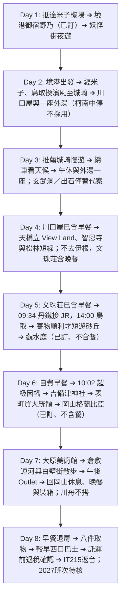

# 🇯🇵 2027 日本山陰・海之京都・山陽 8 天 7 夜

> 一月的山陰，鉛灰色的日本海，雪落在鬼太郎的肩上。  
> 從境港的妖怪街啟程，搭 JR 沿海東行；在城崎溫泉街上，穿浴衣、踏木屐，走訪六間外湯。接著前往日本三景之一的天橋立，登 View Land、走智恩寺與松林短線，最後在倉敷的運河邊為旅程收尾。  
> 八天、六個人，嚐松葉蟹與但馬牛，也把冬日泡到指尖發皺。  
> **米子鬼太郎機場 (YGJ) 進、岡山桃太郎機場 (OKJ) 出**，由西向東一路推進；Day 1 已確定住境港。  
> **每日交通由旅伴逐日討論拍板。** Day 1 已選境港 Plan A；營運時間與班次仍待 2027 年冬季公告確認。  
> 景點取自 Google Maps「Want to go」收藏清單；Day 1 的「御宿野乃 境港」、Day 5 的「觀水庭 こぜにや」、Day 6 & Day 7 連住的「岡山格蘭比亞酒店」均已訂，城崎的「川口屋城崎河畔酒店」已訂兩晚兩間房、含早晚餐、同房續住。

---

## 📌 旅程基本資訊

* **日期**：**2027 年 1 月 11 日（週一）～ 2027 年 1 月 18 日（週一）**，共 8 天 7 夜；**1/11 是日本成人之日國定假日**，須以假日班表規劃。
* **成員**：6 位成人，**兩個家庭、兩間房**；6 位同行者的去回程機票均已完成訂票。**大型行李箱共 8 件（28 吋）**，寄物、置物櫃、計程車與宅急便都以 8 件估算（2026-09-28 更新）。
* **航班資訊（台灣虎航）**：
  * **去程 (IT724)**：1/11 (一) 08:40 台北桃園 (TPE T1) ➔ 12:00 米子鬼太郎 (YGJ)
  * **回程 (IT215)**：1/18 (一) 15:25 岡山桃太郎 (OKJ) ➔ 17:30 台北桃園 (TPE T1)
* **🗓 JR 指定席開賣提醒**（乘車日一個月前同日 10:00 開賣；日本時間，台灣時間 09:00）：
  * **12/12 (六) 10:00**：Day 2 超級松風 6 號（米子→鳥取）＋濱風 4 號（鳥取→城崎），六人兩段指定席。
  * **12/16 (三) 10:00**：Day 6 超級因幡 4 號（鳥取 10:02→岡山 11:49，全車指定席），六人。
  * 可用 JR 西日本 e5489「事前受付」（須會員註冊，一次操作最多六人）：開賣前一週同日 05:30 起至開賣當天 07:59 先登記，10:00 開賣時依序處理，不保證有位（Day 2 為 12/5 起、Day 6 為 12/9 起；05:30 日本時間為台灣 04:30）。班次與座位以購票當時為準。

* **Day 1–2 複核（2026-10-09）**：Day 1 保留 JR 與已確認的八件寄件條件；機場一樓 7-Eleven 即取簡餐、紀念館 45 分鐘合理，早關門店家有需要才在入館前短停。Day 2 午餐 11:30 仍無法入席就改簡餐；票券 11/1 改為境線刷 IC 卡、米子轉乘時領 e5489（米子→城崎溫泉乘車券可在鳥取途中下車）＋兩段指定席特急券，優惠票另核。錯過境線可先詢計程車能否 09:30 前到米子，未確認供車／路況前不視為保證接續；外湯約 16:30～16:35 開始更衣、16:45 前全員穿妥離開浴場、17:15 前回館。晚餐候選及 2027 班次仍保留原確認狀態。
* **Day 8 修正（2026-10-03）**：推薦較早赴機場；09:35 回館、10:05 取妥八件、10:25 前西口候車，10:50→11:20 僅 2026/10 示例，2027 待核。先海關確認再託運；一般約 12:55 開櫃，目標 13:40 報到完成、14:30 登機門。12:55 巴士不再預設，計程車六人八件容量與供車待核；神社僅 JR 可 09:20 前回站的未定條件案。已訂 IT215 15:25／17:30 保留，私人 Word 留本機。
* **Day 6 執行註記（2026-10-31）**：午餐 12:40 無六人座位改較快供餐，入席也先問供餐；13:10 開始結帳、13:20 前結帳離店、13:40 前已到月台，逾時或寄物未妥就取消吉備津，不自動改 14:22。神社約 50 分含登階、候位及集合；15:00 收尾、15:10 在返站參道口集合、15:15 已踏上返站路線、15:35 前到站，必要時縮短迴廊或放棄御朱印。採買主案 16:50 結帳、17:00 前離店；備援 17:25 結帳、17:35 前離店。中辛同款先核，缺貨不追貨、不以うま口替代。取八件、入住後盡量留房內 20～30 分休息；18:10／18:45 出門及 18:30／19:00 晚餐僅目標，延誤聯絡順延。以上為本團緩衝建議。
* **Day 6 已選 A′ 早餐版（2026-10-11 補足執行緩衝；2026 班表參考）**：觀水庭不含早餐；前晚安排六人自費早餐，09:20 離館、09:40 前到站，參考 10:02→11:49 超級因幡（全車指定席、¥5,600／人）。11:49～12:25 含出站、步行與八件寄物，12:25 起午餐、13:10 開始結帳、13:20 前離店，13:40 前到吉備線月台；參考 13:52→14:07 去，14:25～15:15 參拜、15:35 前回站，15:47→16:05 回，16:30～17:00 買大統領。16:17 回程備援成立才改 17:05～17:35 採買，17:35～18:05 回館、18:05～18:45 取八件與入住休息、18:45 出門；19:00 晚餐須確認飯店步行 15 分內可到；較遠或入住延誤就協調順延訂位，不壓縮取物與休息。八件後續宅配未定案，不保證上午到貨；2027 班次／座位／營業、寄物容量與同款庫存待核。岡山城、後樂園不排。
* **Day 7 執行註記（2026-10-31）**：午餐入席先問供餐，12:40 未入座換較快供餐；13:10 開始結帳、13:20 前結帳離店，延誤刪咖啡／常春藤，保留 14:00 回站步行（遠端、雨天或走慢 13:50）。多店購物或退稅者 16:15 起結帳與登錄，16:30 停止加買、16:45 同一出口帶妥商品集合，排隊延誤就減購物。店內登錄不等於完成出境退稅。晚餐 19:30 結帳、19:40 前離店，留 15～20 分回酒店上樓；20:00 已回房開始裝箱，目標 20:00～21:00。延誤聯絡餐廳並連動順延，仍保留約一小時、當晚完成；晚間不再購物，不把八件整理留到返程早上。以上為本團緩衝建議。
* **Day 7 已選倉敷（2026-10-03 複核）**：09:30～11:20 先看大原、11:20～12:20 白壁運河短線、午餐後咖啡／常春藤擇一；14:00 回站、14:30～16:30 Outlet、16:45 集合，目標 18:00 回館放袋休息、18:30 六人自費晚餐（未訂）、20:00～21:00 八件裝箱。早餐未含；川舟不搭，蒜山與鷲羽山不去。大原日曆 1/17 未列休館；JR 08:26→08:43 僅 2026 示例，2027 去回待核。退稅消耗品特殊包裝已取消，商品按本人各次購買紀錄保留，Day 8 託運前海關確認。
* **Day 5 執行註記（2026-10-31）**：午餐出發前備妥，08:30 結束早餐、09:00 離館、09:10 到站；豐岡 11:10 前全員八件到 JR 乘車處，城崎 11:45 前候車，不預設車上可吃便當。旅館支線須先確認完整流程；14:15 已寄妥八件並準備離館、14:30 六人到乘車處。等車、分批搬運或列車延誤就取消砂丘，15:00 起入住。砂丘約 15:25～15:30 折返，15:50 全員已離開砂地、16:10 前到站牌；16:50 僅漏班備援。若 17:12 才回站，先取物、回館入住並保留房內 20～30 分休息，18:00 出門／18:30 晚餐僅目標，延誤聯絡店家順延。以上為本團緩衝建議。
* **Day 5 已選 A′ 早餐版（2026-10-10 複核）**：吃文珠荘已含早餐，搭現行示例 09:34 丹鐵、經豐岡與城崎轉 JR，14:00 到鳥取（自由席參考 ¥3,420／人，不保證六人同區座位）；午餐提前準備，不在城崎 24 分鐘轉乘時出站找店。先確認站內八件寄物，或事前確認可及時回站的旅館接送與寄物流程；旅館來回步行不作預設接法。確認採用旅館支線才要求 14:15 前寄妥離館，且在 14:30 前六人到齊鳥取站乘車處，才搭 14:40→15:02 砂丘線短遊約 45 分，16:20 回；否則先去觀水庭、15:00 起入住。07:45 早班 A 與白兔計程車 B 未採用。觀水庭晚餐及次日早餐均未含；2027 班次、寄物與六人座位待核。站內免費寄物限麒麟獅子一日券實際使用者，不套用本案 39 砂丘線；16:50 備援回程時晚餐目標約 18:30，店家未訂位。
* **Day 5 晚餐候選順序（均未訂位）**：① 炭火焼ジュジュアン；② 焼肉牛王 鳥取駅北口店。兩家均有萬葉牛／鳥取和牛，也有不吃牛肉者可選的豬、雞、海鮮；第一家另列大山豚與鹿野地雞。實際菜色、2027/1/15 營業及六人席位待確認，觀水庭訂房不含晚餐。
* **Day 4 執行註記（2026-10-31）**：08:10 結束早餐、約 08:20 全員與八件行李到大廳、08:25 前退房備妥，08:30 接駁發車；容量及到站時間先核，延誤提前請館方協助。豐岡 09:35 前到丹鐵候車處、不站外採買。午餐 12:00 未入席改較快供餐，先問供餐速度；12:30 開始結帳、12:40 前結帳離店完成，13:00 上山僅目標。山頂約 43 分含集合候車，13:40 回候車處；順延 13:20 上／14:10 下就縮短散步，若預估再順延則取消登高，保留平地短遊與 15:30 入住。單軌 40 人先到先上，不保證六人同班；以上為本團緩衝建議。
* **Day 4 補充複核（2026-10-09）**：保留 41 分鐘豐岡換乘，先辦 JR／丹鐵票券及八件移動，建議 09:35 前全員到丹鐵候車處。午餐新增橋立大丸本店／松和物産候選，均未訂位；View Land 展望餐廳已公告 2027/1/14 休業、はしだて茶屋固定週四休，不作備案。單軌 40 人先到先上，13:00 上／13:50 下為目標，午餐與候車延誤先縮短松林。
* **Day 4 已選 B 天橋立（2026-10-02 修正）**：07:30～08:10 早餐、08:10～08:25 完成退房、08:30 送站。現行 08:58→豐岡 09:10、09:51→天橋立 11:05，轉乘 41 分鐘；09:33 特急版僅 9 分鐘，不列常態安排。八件先按隨人移動，接駁與寄物容量先核。11:05～11:40 文珠荘寄物、11:40～12:40 午餐、12:45～14:30 View Land、14:30～15:30 智恩寺與松林短線、15:30 入住；**不去伊根**。文珠荘已訂兩間房、含早晚餐，晚餐時段待確認；2027 列車／天候另核。
* **Day 3 補充複核（2026-10-09）**：城崎慢遊主線維持推薦、待旅伴拍板。鴻之湯管理單位已列 2026/10/28 重開，取代「預計 11 月」，實際復業及 2027/1/13 當日仍核；午餐 12:20 入席不保證 13:00 前已結帳離店，另核供餐。新增 Lawson 城崎湯島外帶簡餐候選，延誤仍保留午休、縮短或取消外湯。
* **Day 3 查核（2026-11-01）**：纜車、外湯、海中苑、川口屋時段均與官網相符，慢遊節奏不變。纜車冬季（至 1/31）最後一班 16:30 上、16:50 下，不影響 10:30 主案；鴻之湯已於 10/28 復業，可作週三備選；玄武洞 2026 年一月每週三休園，1/13 很可能休園，外出改以出石為主。
* **Day 3 修正（2026-10-04）**：仍推薦城崎慢遊、尚未代旅伴拍板。09:30 出發，纜車目標 10:30 上、11:10 下，留到 11:30 走下 97 階；海中苑僅午餐候選，11:45～12:00 抵店現場候位，預估 12:20 仍無法入席就改簡餐；約 13:15～13:30 回房午休，清掃完成時間需協調（清掃外可回房已確認）。14:30～16:30 步行御所之湯；午休約一小時；14:30 後才回房就縮短或取消餐前外湯，有餘裕才評估旅館 15:30 首班，外湯約 15:30～17:15、刪減採買，17:15 前回館。18:00 晚餐已確認，第二晚おまかせ会席。2027 當日營業待核。
* **Day 3 執行註記（2026-10-31）**：纜車 11:00 左右回候車處，錯過 10:30 可評估 10:50 並縮短散步；若須 11:10 才上山就取消登高。午餐預估 12:20 仍不能入席改簡餐，先核供餐，12:50 開始結帳、13:00 前離店，另留 15～30 分鐘回館。午休約一小時；14:30 後才回房則縮短或取消餐前外湯，15:30 車不必搭。延後外湯 16:30～16:35 更衣、16:45 前穿妥離場、17:15 前回館、18:00 晚餐。以上為本團緩衝建議。
* **Day 1 執行補充（2026-10-31）**：13:40 左右離開航廈、13:55 前全員到乘車處；預填八張單、抵館立即交寄。若當日 15:00 截止，須提前抵館辦妥，14:30～15:10 僅在截止允許時適用。趕不上 14:11 即聯絡飯店並詢六人八件計程車；飯店確認晚到仍可交寄才搭 15:13 晚班並取消紀念館。晚餐六人訂位與 e5489 取票地點列出發前待辦；JR 已查到 2027/1/11 當日班表（2026-11-01）；境港站不能領 e5489 紙票。 八件已定案 1/11 寄往川口屋，無積雪等影響時預計 1/12 上午到；紀念館目標 15:35～16:20，17:00～17:40 入住、18:00～19:30 晚餐，夜遊可刪。詳見 itinerary.md 的時間表、交寄註記與延誤備案。
* **Day 1 查核（2026-11-01）**：航班、境線 2027/1/11 班表與票價、御宿野乃、紀念館、點燈時間均與官方資料相符。補充：廉航無機上餐，機場 7-Eleven 要買足午餐；紀念館假日可能候位入館，官方線上票 ¥1,000、不指定時段、不可退，確定趕得上再買；八件運費 ¥24,160 為同區運價推算，鳥取→兵庫可能較高，出發前試算。
* **Day 2 修正（2026-10-04）**：採用 Plan B、兩段特急指定席；八件第一天交寄，第二天輕裝、不在退房時才寄。06:30～07:15 早餐、07:30～07:40 退房離館、07:45 前抵境港站，08:05→米子、09:52 超級松風、12:56 濱風→城崎 14:11（現行示例，2027 待核）。鳥取 10:57～11:10 出站找店，11:10～12:10 閘外站區魚鮮水產午餐（已選、未訂位）、12:30 前回月台，不需八件置物櫃。4 分鐘鳥取轉乘不列預設備案；濱坂 2 分鐘接續亦須 JR 確認。川口屋兩晚 18:00 開席已確認；柯南中停不採用。
* **Day 2 查核（2026-11-01）**：2027/1/12 三段列車時間全部吻合。1/12 為淡季，兩段指定席各 ¥1,530，每人 ¥6,470、六人 ¥38,820。境港站早上沒有窗口與站員，改為境線刷 ICOCA／Suica，米子轉乘時領 e5489（米子→城崎溫泉乘車券＋兩張特急券），總價不變。雪天繞姬路時改在和田山轉 17:20 きのさき 9 號，18:00 到城崎。午餐「官網半包廂」查無依據，包廂與座位訂位時問。
* **Day 2 執行註記（2026-10-31）**：06:50 仍未入席就縮短早餐或用預備簡餐，07:15 離席、07:40 前離館；午餐 11:30 未入席改簡餐，先確認供餐、12:00 開始結帳、12:10 前離店、12:30 前回月台；外湯 16:30～16:35 開始更衣、16:45 前全員穿妥離開浴場、17:15 前回館。候位或入住延誤縮短、取消餐前外湯，保留 18:00 晚餐。以上是本團執行緩衝，非業者保證。
* **交通方式**：以 [`trip_discussion.html`](./trip_discussion.html) 各日拍板的方案為準。Day 1 已確定為米子空港站至境港的 JR 境線；Day 2 自境港搭境線銜接山陰本線，已採用 Plan B 於米子、鳥取轉乘，以濱風直達城崎（2027 同日接續待確認）。跨日移動與冬季班次在訂票及出發前仍須逐項確認。
* **重點名宿**：**Day 1 入住【御宿野乃 境港】已訂、含 Day 2 早餐、不含 Day 1 晚餐**；**Day 4 入住天橋立【和のリゾート 文珠荘】已訂 2 間房、含早晚餐**；**Day 5 入住鳥取溫泉【觀水庭 こぜにや】已訂、不含餐**；**Day 6 & Day 7 連住【岡山格蘭比亞酒店】已訂、不含餐**；**Day 2 & Day 3 城崎溫泉【川口屋城崎河畔酒店】已訂兩晚兩間房、含早晚餐、同房續住**。文珠荘 2 間房已確認，晚餐時段待確認；早晚餐已含。

### 已訂住宿餐食（2026-09-27 使用者確認）

| 住宿夜 | 住宿 | 當日晚餐 | 次日早餐 |
| :--- | :--- | :--- | :--- |
| Day 1・1/11 | 御宿 野乃境港 | 未含，自行安排 | Day 2 已含 |
| Day 2–3・1/12–13 | 川口屋城崎リバーサイドホテル | Day 2、3 均已含 | Day 3、4 均已含 |
| Day 4・1/14 | 文珠荘 | Day 4 已含 | Day 5 已含 |
| Day 5・1/15 | 観水庭こぜにや | 未含，自行安排 | Day 6 未含，自行安排 |
| Day 6–7・1/16–17 | Hotel Granvia Okayama | Day 6、7 均未含，自行安排 | Day 7、8 均未含，自行安排 |

已含與未含僅指訂房餐食；餐廳候選、旅館另外付費供餐及六人訂位仍依實際安排。

---

## 🗂️ 專案文件導航

| 文件 | 說明 | 連結 |
| :--- | :--- | :--- |
| **📄 Word 行程企劃書** | 在討論頁按「輸出 Word 企劃書」，依當前的拍板結果產生 | [`trip_discussion.html`](./trip_discussion.html) |
| **每日行程表** | 詳細 8 天每日時間軸、動線、景點與餐飲推薦 | [`itinerary.md`](./itinerary.md) |
| **交通指南（含自駕方案）** | 航班；🧳 第一段八件行李寄送已定案、後續區段待決定；以及自駕方案採用時的雪胎租車守則與各景點 MapCode & 電話導航速查 | [`transportation.md`](./transportation.md) |
| **景點情報庫** | 收錄米子、境港、柯南小鎮、城崎溫泉、天橋立、伊根、鳥取砂丘、吉備津神社、倉敷等景點詳情 | [`spots.md`](./spots.md) |
| **預算與記帳** | 旅途預算試算與即時記帳追蹤 | [`budget.md`](./budget.md) |

---

## 🗺️ 8天7夜大環線概覽

---

## 📷 參考來源
* Google Maps 收藏清單：`https://maps.app.goo.gl/XTtR3CuELBJGkGSe7`
* Google Maps 收藏清單地圖截圖（米子・境港一帶收藏點）：[`截圖 2026-09-05 10.58.13.png`](./截圖%202026-09-05%2010.58.13.png)
* 指定入住飯店：`https://www.kawaguchiya.co.jp/`
* 手繪行程路線規劃圖：[`S__46088321.jpg`](./S__46088321.jpg)
