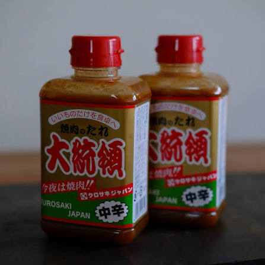

# 🗓️ 每日詳細行程表 (Detailed 8-Day Itinerary)

> **旅程企劃：2027 日本山陰・海之京都・山陽 8 天 7 夜大環線自由行**  
> **航班動線：米子鬼太郎機場 (YGJ) 進 ➔ 岡山桃太郎機場 (OKJ) 出（不走回頭路黃金動線）**  
> **成行日期：2027 年 1 月 11 日（一）～ 2027 年 1 月 18 日（一）**  
> **已整合 Google Maps「Want to go」收藏景點（青山剛昌柯南小鎮、由良車站、玄武洞博物館、鴻之湯、曼陀羅湯、吉備津神社長迴廊、三井Outlet、瀨戶大橋等）**  

> ⚠️ **行程尚未完全拍板**：不假設全程單一交通方式；以 [`trip_discussion.html`](./trip_discussion.html) 的日別方案為準。Day 1 已確定入住御宿野乃境港、採 JR 境線；Day 2 與 Day 4~8 已以 JR、路線巴士或計程車規劃。營運資訊均須在 2027 年冬季時刻表發布後重新確認。

---

## 📅 行程總覽架構表 (At a Glance)

| 天數 / 日期 | 核心停留區域 | 當日行程重點亮點 (含 Google Maps 收藏景點) | 預估移動車程 | 住宿飯店規劃 |
| :--- | :--- | :--- | :--- | :--- |
| **Day 1** 1/11 (一・成人之日) | **境港** | 抵達米子機場 (12:00) ➔ JR 境線 ➔ 御宿野乃 境港（已訂、先交寄八件至川口屋）➔ 水木茂紀念館／可選夜遊 | 現行參考：JR 約 15 分 **2027/1/11 班表已查（11/1）** | **御宿野乃 境港 已訂** |
| **Day 2** 1/12 (二) | **境港出發** 城崎溫泉 | **採用 Plan B、輕裝**：境港→米子→鳥取站區午餐→城崎川口屋；濱風 4 號直達，入住後外湯一座。柯南中停（舊 Plan A）已不採用。 | **全程 JR、非全程直達**：米子、鳥取轉乘（2 次）；普通車備案鳥取 13:33 直達。 2027/1/12 當日班表 08:05→14:11 **已查（11/1、11/7）**，出發前只看臨時異動 | **城崎溫泉** **川口屋城崎河畔酒店** 已訂兩晚兩間房、含早晚餐、同房續住 👑 |
| **Day 3** 1/13 (三) | **城崎溫泉** | **推薦 Plan B**：早餐 ➔ 纜車看天候 ➔ 老街午餐 ➔ 午休 ➔ 御所之湯優先、外湯一座 ➔ 川口屋晚餐。Plan A 只剩出石（玄武洞 1/13 休園），僅作替代、不疊加。 | 步行為主，纜車可刪；出石案須另核 2027 巴士往返。 | **川口屋城崎河畔酒店** 已訂連住第 2 晚；兩間房、含早晚餐、同房續住 👑 |
| **Day 4** 1/14 (四) | **海之京都** 天橋立 | **已選 B 天橋立**：川口屋早餐後 11:05 抵達；View Land 飛龍觀、智恩寺與松林短線；**不去伊根**。 | **JR 城崎溫泉 ➔ 豐岡轉丹鐵 ➔ 天橋立** 2027/1/14 班表已查 | 天橋立（文珠） **和のリゾート 文珠荘 已訂** |
| **Day 5** 1/15 (五) | **山陰海岸** 鳥取市區 | **已選 A' 早餐版**：文珠荘已含早餐 ➔ 09:34 出發、14:00 抵鳥取 ➔ 砂丘條件式短遊 ➔ 已訂觀水庭；晚餐自理。白兔與城跡不排入｜**砂之美術館不入館** | 現行示例：丹鐵＋JR 經豐岡、城崎兩次轉乘；2027 同日接續待核 | **鳥取溫泉 觀水庭こぜにや 已訂** |
| **Day 6** 1/16 (六) | **穿越山地** 岡山・吉備路 | **已選 A' 早餐版**：自費早餐 ➔ 10:02 超級因幡直達 ➔ 吉備津神社 ➔ 表町大統領採買；**岡山城、後樂園不排入** | **JR 特急**：鳥取至岡山 現行示例 10:02→11:49；2027 待複核 | **岡山格蘭比亞酒店（已訂）** 連住第 1 晚 |
| **Day 7** 1/17 (日) | **倉敷美觀** 三井Outlet | **已選 Plan A**：大原美術館 ➔ 倉敷運河與白壁街散步 ➔ **【Google Maps】三井 OUTLET PARK 倉敷** ➔ 岡山晚餐；川舟不搭、蒜山與鷲羽山不去 | 岡山至倉敷 JR 約 17 分；全程步行銜接 | **岡山格蘭比亞酒店（已訂）** 連住第 2 晚 |
| **Day 8** 1/18 (一) | **岡山市區** 返台 | 前晚裝箱、早餐退房與八件取物 ➔ 西口 21 號站牌較早巴士至岡山桃太郎機場 (OKJ) ➔ 託運前退稅確認 ➔ 15:25 搭乘 IT215 飛往台北 ➔ 17:30 抵達桃園 | 市區至機場 巴士 11:10 約 30 分（冬季表已核） | 溫暖的家 |

---

## 📌 每日詳細動線與時間表

### Day 1：2027-01-11（週一・成人之日）｜抵達山陰 ➔ 境港御宿野乃（已訂）➔ 妖怪街夜遊

> **已確定：境港 Plan A、御宿野乃 境港（已訂）。** 六位成人以 JR 境線進境港，下午以紀念館為目標、晚餐後夜遊。**2026-10-09 複核**：IT724 冬季班表已公告；**2026-11-01 已查到 2027/1/11 當日 JR 班表**（成人之日走土休日表），出發前只需再看臨時異動；本日不能套用平日表。

#### 建議時間表｜候車簡餐，八件行李先交寄，再逛紀念館

| 時間（抵日後為日本時間） | 安排 | 執行重點 |
| :--- | :--- | :--- |
| 08:40 台灣時間 → 12:00 日本時間 | IT724 桃園 → 米子 | 冬季官方班表已公布且吻合；六人機票已訂，最後仍以訂位通知為準。早餐出發前處理。 |
| 12:00～13:30 | 入境、領行李、洗手間與整隊 | 預留約 90 分鐘，非保證出關時間。 |
| 13:30～13:40 | 機場即取簡餐或補給 | 以機場一樓 [7-Eleven](https://www.yonago-air.com/shop/seven-eleven) 即取餐點為主（現行 06:00～22:00）；10 分鐘每人買飯糰／麵包加飲料當午餐：廉航機上沒有免費餐，到 18:00 晚餐前沒有正式午餐，搭車或交寄後吃。來不及就先帶走，不為候餐耽誤 13:40 左右離開航廈。2027/1 店家營業待核。 |
| 13:40～13:55；13:55～14:11 | 步行至米子空港站、辦票與候車 | 13:40 左右離開航廈，六人八件抓 10～15 分鐘移動，13:55 前全員到乘車處，核對票券、方向與上車位置；搭往境港方向，不先去米子站。 |
| 14:11～14:26 | JR 境線：米子空港 → 境港 | [2027/1/11 當日班表](https://timetable.jr-odekake.net/line-timetable/2412?date=20270111)（2026-11-01 查，土休日表）；出發前再看臨時異動。車上有 IC 讀卡機，ICOCA／Suica 可用。 |
| 14:30～15:10 | 御宿野乃交寄八件行李至川口屋 | **已定案：1/11 交寄八件，無積雪等影響時預計 1/12 上午送達川口屋。** 抵館優先填單、核對姓名／入住日與件數、付款並留存八件託運編號；隨身保留兩晚換洗用品，必要藥品、證件及貴重物品全程隨身。預填八張單，預留 30～40 分鐘。當日集貨截止約 15～16 時，此時段通常趕得上；趕不上截止也照常交給櫃台、改 1/12 集貨（見延誤備案，待旅館確認）。入住及觀光不得耽誤交寄。 |
| 15:10～15:35 | 沿妖怪街走向紀念館 | 交寄完成後出發，少量拍照，一般購物留回程；如想買早關門的妖怪食品研究所和菓子，入館前順路短停，有排隊就略過。 |
| 15:35～16:20 | 水木茂紀念館 | 預留約 45 分鐘，符合館方 FAQ 的 30 分鐘～1 小時參觀目安；現行 09:30～17:00、最終入館 16:30。預估無法 16:00 前入館則取消，不犧牲交寄時間。假日人多時館方可能請候位入館；[官方線上票](https://www.jtb.co.jp/leisure/m/pE1031199/)（JTB）¥1,000、與現場同價，不指定時段、購買當日起 29 天內可用、不可退，確定 16:00 前到得了再在路上買，可省排隊買票。夜間語音導覽套票 11/7 在 JTB 與館方頁面都查不到，不列入。 |
| 16:20～17:00 | 妖怪街回程、購物 | 依各店營業時間調整，不把購物全部留到夜遊。 |
| 17:00～17:40 | 正式入住、休息 | 住宿已訂；先確認晚餐安排。 |
| 17:40～18:00 | 前往晚餐地點 | 館內自助或站周邊海鮮餐廳仍待選、均未預訂；外出者依步行距離準備 18:00 入席。 |
| 18:00～19:30 | 晚餐（訂房不含） | 餐廳選定、1/11 假日營業與六人 18:00 座位須先確認；館內晚餐是否可加訂依旅館回覆。 |
| 19:30～20:00 | 妖怪街光影散步（可刪） | 晚餐安排 18:00～19:30；餐後夜遊看體力與天候，可只走附近 15～30 分鐘或直接回館。現行日落至 22:00。 |
| 20:00 後 | 回飯店泡湯、休息 | 12 樓天然溫泉，現行大浴場 15:00～翌 10:00（三溫暖 01:00～05:00 暫停）；館方另有夜鳴きそば，時段依館內公告。Day 2 早餐先到先入座，06:30 開餐就去，保留睡眠。 |

> **交寄註記（2026-11-14 修訂）**：預填八張單，抵館立即交寄。當日集貨截止約 15～16 時，14:30～15:10 交寄通常趕得上；趕不上截止也照常交給櫃台，改 1/12 集貨、1/13 到川口屋（見延誤備案，待旅館確認），不為趕截止改搭計程車或犧牲行程。八件受理與寄送條件維持已確認，仍保留天候延誤可能。

#### 早到與延誤分支

* 早到且來得及到乘車處，可搭 13:09→13:24，先到御宿野乃完成八件交寄，再午餐與逛街；14:11→14:26 主方案通常趕得上當日集貨截止。以上為 2027/1/11 當日班表（2026-11-01 查）。
* **延誤備案（2026-11-14 修訂）**：趕不上 14:11 就搭 15:13→15:28 下一班，抵館照樣把八件交給櫃台，不為趕集貨截止去搶計程車。若已過當日截止，改為 1/12 集貨、無積雪等影響時 1/13 送達川口屋（御宿野乃 9/29 回信即以此為例）；1/12～13 都住川口屋，隨身包本來就帶兩晚換洗，**Day 2 照樣輕裝**。代價是抵抗下雪延誤的緩衝從兩天減為一天，所以準時交寄仍是首選；1/13 晚上仍未到，就用託運編號聯絡ヤマト追蹤或改送後續住宿。**須先向御宿野乃確認：截止後交寄的包裹可保留到隔日集貨。** 計程車只在想保住紀念館時考慮，須先確認六人八件的車型、足夠台數、候車與總價，不視為保證備援；預估 16:00 前進不了紀念館就取消入館。JR 為 2027/1/11 當日班表（2026-11-01 查）。
* 機場現列至境港站計程車約 15 分、¥2,400／車，僅參考、非本次報價；六人加行李須另確認台數／大型車、候車與總價，不能假設一台普通車足夠或即叫即到。機場建議提前預約。
* **交寄優先**：御宿野乃已確認受理ヤマト宅急便；2026-10-04 已確認 1/11 沿用原寄件條件：八件可受理、約 15～16 時截止，無積雪等影響時預計 1/12 上午到。先預填八張託運單，避免到館後才開始整理。紀念館寄物不能取代寄送；若接近截止，先請櫃台核對能否當日交寄，趕不上就留待隔日集貨（見延誤備案），不必為此調整交通或取消入館。
* **預估無法在 16:00 前進紀念館，就取消入館**，保留老街、入住、晚餐與泡湯；不追 16:30 最終入館。
* 水產直賣中心、美保關、夢港塔均不列入第一天主行程。

#### 下雪與行李提醒（2026-11-14）

* **班機**：米子機場大雪時須除雪，IT724 可能延誤；前一晚與當天早上看虎航與機場公告，延誤就照上方延誤備案。
* **機場到米子空港站**：步行約 5 分，路面可能積雪或是雪水。八件先套防雨套或大垃圾袋，電子用品與文件放夾鏈袋；輪子在雪上不好拉，必要時提著走。
* **計程車**：雪天叫車的人多，機場官方本就建議預約。出發前預報大雪，就先問有沒有能載六人八件的大型車與總價；未確認前不視為保證備援。
* **行李重量**：ヤマト宅急便 160 尺寸限 25 kg，180／200 尺寸限 30 kg，尺寸與重量取較大的一級計價（[ヤマト 2021 公告](https://kyodonewsprwire.jp/release/202107207909)；2026-11-14 查）。冬季 28 吋箱容易超過 25 kg，運費以 180 尺寸 ¥29,440 預留較保險；超過 30 kg 不受理，出發前在家秤重。

#### 餐飲與費用

**已訂房不含晚餐**（2026-09-26 使用者確認），晚餐另選另付；以下三案均**未預訂**，2027 營業與價格出發前複核。討論優先順序為 **2 和泉 → 3 海鮮ふぐ料理 殿 → 1 御宿野乃館內自助**，僅表示比較順序，尚未選定。

| 選項／晚餐候選 | 營業／休日（現行） | 座位與價位 | 位置與備註 |
| :--- | :--- | :--- | :--- |
| 1 御宿野乃館內自助 | 17:00～21:00，90 分鐘制、最後點餐 20:30 | 住宿客成人 ¥4,000，六人 ¥24,000；天婦羅、壽司可續取 | 不用再出門，最省力；**旅館 9/29 回覆目前仍可加訂，但達一定份數就停止受理**，想保留此選項須提早決定。[來源](https://dormy-hotels.com/dormyinn/hotels/nono_sakaiminato/breakfast/) |
| 2 和泉（地魚居酒屋） | 17:30～22:00；週四休（另有資料列第 4 週三休） | 23 席（吧台 11、座敷 12）；晚餐約 ¥3,000～3,999／人 | 境港站步行約 8～10 分；網路訂位未獲確認，六人 18:00 座位、假日營業與包場條件以電話詢問為準。[Hot Pepper](https://www.hotpepper.jp/strJ000772698/) |
| 3 海鮮ふぐ料理 殿 | 公開資料有差異：[ぐるなび](https://r.gnavi.co.jp/ezx49upe0000/)現列 16:30～22:00、不定休；原稿 16:00～23:00 不作已確認時間 | 河豚與海鮮；六人座位、包廂與價格待店家確認 | 境港站約 850 m、步行約 15 分。[官網](https://kaisen29-tono.com/)；**11/14 官網網域已失效、ぐるなび 無回應，訂前先電話確認仍營業。** |

1/11 是成人之日，兩家外部餐廳的 **2027 當日營業與六人座位須在訂位時一併確認**。外出用餐約 17:40 從旅館出發，目標 18:00 入席；19:30 是預估結束時間，套餐依供餐調整。若選沿街的和泉，餐後順路看光影回館；夜遊可刪。館內自助限量，不能視為外部餐廳沒位時一定可用的臨時備案。

**Day 2 早餐銜接**：現行早餐 06:30～09:30（最終入店 09:00，1F 和洋自助與海鮮丼），Day 2 早餐已含於訂房。**旅館 9/29 回覆：早餐先到先入座，客滿時需等候**；推薦案 08:05 境港發，建議 06:30 開餐就入座，最晚 06:45 到餐廳。

**基本交通與門票**：JR ¥190＋紀念館 ¥1,000＝¥1,190／人，六人 **¥7,140**。八件交寄運費另計（參考 ¥24,160／¥29,440；2026-11-07 已用ヤマト官網查鳥取→兵庫現金價：160 尺寸 ¥3,020、180 尺寸 ¥3,680／件，八件即此金額；キャッシュレス每件少 ¥5～6）；不買周遊券，住宿、餐飲、計程車另計。若取消入館扣除門票；計程車取代 JR 時不重複加計。

**御宿野乃回信（2026-09-29）**：① 入住前可寄放行李，寄放時填姓名與件數；② 早餐先到先入座，客滿需等候；③ 館內自助晚餐目前可加訂，達一定份數即停止受理；④ 櫃台受理ヤマト宅急便、可領託運單，當日集貨截止約 15～16 時，原回信以 1/12 集貨、無積雪等影響時 1/13 上午送達為例；**本次已決定改為 1/11 交寄、目標 1/12 到川口屋，2026-10-04 使用者確認寄件條件相同：八件可受理、約 15～16 時截止，無積雪等影響時預計 1/12 上午到；仍保留天候延誤可能。**

**2026-10-09 補充查核**：紀念館 [FAQ](https://mizuki.sakaiminato.net/faq/)列參觀約 30 分鐘～1 小時，保留原 45 分鐘安排。[妖怪食品研究所](https://www.kenkyujo.jp/m/index.html)目前列 09:30～16:00、不定休且可能提前售完；只作有需要時的入館前短停，不列必到。2027 當日營業另核。八件受理與約 15～16 時截止沿用既有確認，JR 主方案不變。

**出發前待辦（2026-10-31 補充）**：

- ~~複核 2027/1/11 假日 JR 班次與票價~~：11/1、11/7 已查當日班表，出發前只看臨時異動；機場店家 2027/1 營業仍待核。
- 向御宿野乃確認：集貨截止後交寄的包裹可保留到 1/12 集貨（延誤備案的前提）。
- 出發前在家秤八件重量：超過 25 kg 按 180 尺寸計，超過 30 kg ヤマト不受理。
- 選定 Day 1 晚餐，確認假日營業與六人 18:00 座位；館內自助須事先聯絡，不視為保證備案。
- 安排 e5489 取票車站及時間：[境港站](https://eki.jr-odekake.net/top?id=0641710)不受理 e5489 取票。不為取票先繞米子；已定 Day 2 在米子站轉乘時領票（窗口 07:00～19:30、售票機 05:00～23:30，受理 e5489；須用訂票時的信用卡）。
- 備妥八張託運單並留存託運編號，Day 2 依編號追蹤配送；八件受理與寄送條件沿用已確認紀錄。

**2026-11-01 第一天查核**：IT724 週一 08:40→12:00、境線 ¥190、御宿野乃（境港站步行約 1 分、入住 15:00、早餐／館內晚餐／12 樓大浴場時間）、紀念館 09:30～17:00（最終入館 16:30、全年無休、¥1,000）、妖怪街日落至 22:00 點燈、和泉週四休，均與官方或店家頁面相符；JR 已查到 2027/1/11 當日班表。妖怪銅像以 177 座計（2022 年資料）。海鮮ふぐ料理 殿的頁面本次無法開啟，維持待店家確認。

**2026-11-07 第一天複查**：IT724 週一 08:40→12:00（冬季班表 2026/10/25～2027/3/27）；境線 2027/1/11 土休日表 13:09→13:24、14:11→14:26、15:13→15:28 不變（JR 時刻表 2026 年 11 月號資料）；機場步行至米子空港站約 5 分、¥190、境線可刷 IC（2019 年起車載讀卡機）；7-Eleven 06:00～22:00；計程車至境港站約 15 分、約 ¥2,400，官方建議預約、未列大型車。御宿野乃大浴場 15:00～翌 10:00、早餐 06:30～09:30、館內自助 ¥4,000（90 分、限量須事先聯絡）均相符；夜鳴きそば時段官網未列。紀念館 09:30～17:00、¥1,000、年中無休，無臨時休館公告；館內沒有置物櫃，大件行李可交寄物處。JTB 線上票購買當日起 29 天內可用、不可退。**更正**：妖怪銅像改為 178 座（館方現行頁面）；夜間語音導覽 ¥1,400 套票查不到，刪除。八件運費用ヤマト官網查 684-0004→669-6101：現金 160 尺寸 ¥3,020、180 尺寸 ¥3,680／件，與 ¥24,160／¥29,440 相符；今天寄出顯示隔天上午可到（1/11 當天仍以櫃台為準）。和泉週四休、17:30～22:00 不變。殿官網本次可在搜尋結果看到但連線失敗；各站時間不一（官網 16:00～23:00、ぐるなび 16:30～22:00，週末另有午市），未見歇業消息，電話 0859-44-2929 確認。成人之日 1/11 經內閣府確認。

**2026-11-14 第一天複查**：IT724 週一 08:40→12:00（冬季班表 2026/10/25～2027/3/27，無停飛公告）；境線 2027/1/11 米子空港 13:09→13:24、14:11→14:26、15:13→15:28，¥190；機場 7-Eleven 1F 06:00～22:00；計程車至境港站約 15 分、約 ¥2,400，官方建議預約、旺季或清晨可能約不到；御宿野乃早餐 06:30～09:30、館內自助住客 ¥4,000（90 分、限量須事先聯絡）；紀念館 09:30～17:00（最終入館 16:30、年中無休、¥1,000；無置物櫃、大件可交服務台；離館後不能再入館）；和泉晚間 17:30～22:00、週四休、23 席，均不變。**殿**：ぐるなび 無回應（503），**官網網域已無法解析**，營業狀態上網確認不了；若要訂，先打 0859-44-2929 確認仍營業。

**官方查核來源（2026-09-25）**：[冬季航班](https://www.yonago-air.com/flight/taiwan)、[2026 假日 JR 班表（第 2 頁）](https://www.sakaiminato.net/wp/wp-content/uploads/2026/03/2026.03.14.pdf)、[JR 票價](https://www.yonago-air.com/access/train)、[機場步行與餐飲](https://www.yonago-air.com/faq)、[計程車](https://www.yonago-air.com/access/taxi)、[紀念館](https://mizuki.sakaiminato.net/information/)與[寄物 FAQ](https://mizuki.sakaiminato.net/faq/)、[妖怪街光影](https://mizuki.sakaiminato.net/road/)、[飯店餐飲](https://dormy-hotels.com/dormyinn/hotels/nono_sakaiminato/breakfast/)與[入住前寄物 FAQ](https://dormy-hotels.com/dormyinn/hotels/nono_sakaiminato/faq/)。

---

### Day 2：2027-01-12（週二）｜境港出發 ➔ 鳥取轉乘 ➔ 城崎川口屋與外湯

> **2026-09-26 複核：採用 Plan B**（2026-09-26 使用者決定：故鄉館預告冬季搬遷閉館，柯南中停不採用）。 出發地確定是「御宿野乃 境港」，上午退房後搭 JR，下午以入住城崎與一座外湯為主。川口屋已訂兩晚兩間房、含早晚餐、同房續住（2026-09-18 使用者確認）；入住 1/12、退房 1/14。現行入住 15:00～18:00，車站有旅館組合免費入住巴士；兩晚晚餐 18:00 開席已獲旅館同意（9/28 回信）。

#### 採用 Plan B｜輕裝搭濱風 4 號直達城崎

**御宿野乃 → 境港站 → 米子站 → 鳥取站 → 城崎溫泉站 → 川口屋。** 米子至鳥取搭超級松風（六人劃指定席），鳥取至城崎搭「濱風 4 號（はまかぜ4号）」。後段可直達，經濱坂但不下車；全日仍需在米子、鳥取轉乘兩次。

以下三段已於 **2026-11-01 用 2027/1/12 當日班表重查（JR おでかけネット、Yahoo!乘換），時間全部吻合**；這不是訂位，12/12 開賣時確認六人座位，出發前再看臨時異動。境線平日 08:05 是早餐後可用、接上米子 09:52 的最晚班次，下一班 09:18 要到 10:11 才到米子。

| 時間（日本時間） | 安排 | 執行重點 |
| :--- | :--- | :--- |
| 06:30～07:40 | 早餐、整理隨身包、退房 | 06:30～07:15 早餐，07:15～07:30 取隨身包及最後檢查，07:30～07:40 退房離館；隨身包前晚整理好；06:50 仍未入席就縮短用餐或用預備簡餐，07:15 離席、07:40 前離館，不為吃完已含早餐錯過班車。境港站早上無法購票或領 e5489：境線刷 IC 卡，指定席與後段乘車券在米子轉乘時領取。**八件已安排第一天交寄，今天不在退房時交寄、不帶八件搭車**；隨身帶兩晚換洗用品，並查託運進度。 |
| 約 07:45 前 | 抵境港站候車 | 全員確認 IC 卡餘額（境線 ¥330；沒有 IC 卡者用站內售票機買到米子的普通票）；以 07:45 抵站為目標，留足六人找月台與上車時間。 |
| 08:05～08:56 | JR 境線：境港 → 米子 | 普通車約 51 分鐘，境港始發。錯過就接不上 09:52 特急，見下方備案。 |
| 約 08:56～09:35 | 米子站轉乘、洗手間與補給 | 接續約 56 分鐘：先刷 IC 卡出站，到窗口或售票機領 e5489（米子→城崎溫泉乘車券＋兩張指定席特急券），再確認月台，約 09:35 回到乘車處。 |
| 09:52～10:57 | 超級松風 6 號：米子 → 鳥取 | 普通車部分指定席；**決定六人劃指定席**，方便坐在一起。1/12 仍可選自由席（¥1,200）；JR 西日本公告 2027 年春起才全車指定席，在旅行之後。指定席車廂少（一般僅 1 號車），12/12 10:00 開賣就訂；e5489 可在 12/5 05:30～12/12 07:59 先做「事前申込」，12/12 10:00 自動送出，滿席時仍可能失敗。[JR 西日本 2026/8/4 公告](https://www.westjr.co.jp/press/article/2026/08/04/page_30895.html)。特急券另計。 |
| 10:57～11:10 | 下車、出閘、走到餐廳 | 六人只帶隨身包，預留出站與找店時間。 |
| 約 11:10～12:10 | 鳥取站周邊午餐 | 已選三代目網元 魚鮮水產（シャミネ鳥取、未訂位），現行 11:00～23:00，電話 0857-36-7621（11/14 官網連不上，訂位時一併確認營業）。店在閘外站區；包廂與六人座位訂位時詢問（官網本次無法開啟；Hot Pepper 寫半包廂的是米子站前店，鳥取店列有包廂、160 席），不代表當日有位；約 11:10～11:15 入席；訂位時告知後續列車時間，先確認供餐速度，約 12:00 開始結帳、12:10 前離店。11:30 仍無法入席就改即取簡餐；即使 11:30 入席也不保證及時吃完，供餐延誤不壓縮回站時間。只帶隨身包，**不用八件置物櫃，也不安排輪流看大行李**。 |
| 12:10～12:30 | 洗手間、回月台與候車 | 目標 12:30 前回到乘車處，確認車廂位置，距 12:56 發車留 26 分鐘；此表只適用濱風主線，若改 12:21 超級白兔須另排午餐。米子→城崎溫泉乘車券超過 100 公里，可依途中下車規則在鳥取出站；優惠票另按商品規則，詳見下方票券安排。 |
| 12:56～14:11 | 濱風 4 號：鳥取 → 城崎溫泉 | 鳥取始發、普通車全車指定席；2027/1/12 當日班表已查；濱坂停車不用換車。此段不是超級白兔。 |
| 約 14:15～15:00 | 前往川口屋，確認寄送行李 | 14:15 為開始移動的目標，非固定接駁班次或保證抵館時間。站前旅館組合免費入住巴士現行 12:30～18:00、車程約 5 分。向櫃台核對八件是否到齊；未到以託運編號追蹤，不將翌日到貨當成保證。若第一天過了集貨截止才交寄，八件 1/13 才到，屬正常（見 Day 1 延誤備案）。只帶隨身包，不另安排站前八件行李代送。 |
| 約 15:00～16:00 | 正式入住、休息、領外湯券 | 現行入住 15:00～18:00；確認晚餐開席與外湯營業。旅館外湯送客巴士現行 15:30、16:00、16:30、17:00、17:30 發，季節可能調整；只送不接。 |
| 約 16:00～17:15 | 外湯一座＋溫泉街散步 | 可搭 16:00 送客巴士出發；一之湯優先、曼陀羅湯替代，依當日開放與混雜調整；回程步行，包含更衣時間；雪天外湯回程要走路（旅館巴士只送不接），木屐在雪上容易滑，建議穿自己的鞋子與外套出門（2026-11-14 補充）。建議約 16:30～16:35 開始更衣、16:45 前全員穿妥離開浴場、17:15 前回館。候位時先刪散步購物，入住延誤則改館內泡湯。 |
| 約 17:15～18:00 | 回旅館休息 | 晚餐前保留緩衝。 |
| 約 18:00～19:30 | 川口屋晚餐 | 已含晚餐；**18:00 開席已獲旅館同意**（2026-09-28 回信）。 |
| 19:30 後 | 河畔短程散步或館內泡湯、休息 | 館內大浴場現行 15:00～24:00、05:00～09:00；晚間送客巴士 20:00、20:30、21:00。第二座外湯僅為體力足夠時的加選；纜車、出石留在另日候選（玄武洞 1/13 休園）。 |

#### 執行註記（2026-10-31）

- **早餐候位停止點**：06:30 開餐就去；約 06:50 仍未入席，就縮短用餐或使用預備簡餐，保留 07:15 離席、07:40 前離館的目標，不為吃完已含早餐而錯過關鍵班車。
- **午餐與回站**：保留 11:30 候位停止點，仍無法入席就改即取簡餐。即使 11:30 入席也須確認供餐速度；訂位時告知後續列車時間，約 12:00 開始結帳、12:10 前離店、12:30 前回月台。
- **外湯離場門檻**：約 16:30～16:35 開始更衣，16:45 前全員穿妥離開浴場，留約 30 分鐘回館、17:15 前到館。這是本團的緩衝建議；候位或入住延誤就縮短、取消餐前外湯，保留已確認的 18:00 晚餐。

#### Plan B 延誤與替代班次

* **濱風 4 號無法銜接、個別停駛或買不到合適座位**（鳥取—城崎區間本身仍通車時）：現行有鳥取 **13:33 發豐岡行普通車直達城崎 15:28**，不用在濱坂換車、不需指定席，但座位與行李空間不保證。再下一班現行 15:21 鳥取發→濱坂 16:04／16:06 換車→城崎 17:01；濱坂僅 2 分鐘，須先由 JR 確認接續與月台，不直接視為六人可用備案。改搭普通車 15:28 到站後，先入住休息；不保證趕上 16:00 送客車。有餘裕才短泡一座、目標 17:15 前回館，否則改館內或晚餐後泡湯。
* **錯過境港 08:05**：下一班 09:18→米子 10:11 接不上 09:52。可先請旅館／車行評估六人帶隨身包分乘計程車直達米子，只有確認供車與路況能讓全員 09:30 前到站才採用；車資另詢，不保證即叫即到，也不是改成固定包車。無法確認時，先在境港或米子重查完整接續。現行米子 12:23 超級松風 8 號→鳥取 13:29，但 **13:33 普通車只有 4 分鐘轉乘，不列六人團體預設備案**，即使輕裝也需 JR 確認月台與實際接續才評估。較晚 15:21→濱坂 16:04／16:06→城崎 17:01 的 2 分鐘接續亦須車站確認；無法確認就另重查，不保證 17:01 到館。再晚有 16:21 鳥取發豐岡行普通車直達城崎 18:20（不用換車，2027/1/12 查），趕不上 18:00 晚餐，只作最後手段。晚到提前聯絡旅館並取消餐前外湯。
* **天候備案｜山陰本線鳥取—城崎區間停駛**（2026-09-28 查核）：冬季強風或大雪時，這段沿海路線（含餘部橋梁）可能減速或停駛；此時 13:33、15:21 普通車同樣走不了，上面兩條備案都不適用。出發當天早上先看 JR 西日本運行情報（[中國地區](https://trafficinfo.westjr.co.jp/chugoku.html)／[近畿地區，含城崎](https://trafficinfo.westjr.co.jp/kinki.html)），米子轉乘時再看一次。確定停駛時：
  1. 立即聯絡川口屋，告知晚到並確認晚餐能否延後。
  2. 若早上已知停駛，在境港／米子即請 JR 重排全段；仍能抵鳥取並轉乘時，午餐提早結束（目標 11:40～11:50）、至少留 30 分鐘回站與辦票，才評估 **12:21 超級白兔 8 號（スーパーはくと，智頭急行經由）→ 姬路 13:51**；11:00～12:21 之間沒有其他超級白兔。
  3. 姬路 **15:07 播但線**→寺前 16:03→和田山 16:51，轉 **17:20 特急きのさき 9 號→城崎溫泉 18:00**（2027/1/12 班表，指定席 ¥1,090）；不搭特急則 16:54 普通車→豐岡 17:27，往城崎下一班 18:40→18:52，或改搭計程車（約 15 分，費用、六人車型／台數與供車另詢）。或 16:30 播但線→寺前→和田山 18:23→城崎溫泉 19:14（轉 2 次）。
  4. Yahoo!乘換 2027/1/12（淡季）：鳥取→姬路運賃 ¥2,490＋超級白兔指定席 ¥2,360、姬路→城崎溫泉運賃 ¥1,980，繞路段合計約 ¥6,830／人、六人約 ¥40,980；加搭きのさき 9 號指定席 ¥1,090 則約 ¥7,920／人、六人約 ¥47,520（以上為分段買票；2026-11-07 用 Yahoo!乘換通票查詢為 ¥8,180／人：乘車券 ¥4,730＋超級白兔 ¥2,360＋きのさき ¥1,090，實際以窗口為準）。姬路另有較早的 14:33 播但線，同樣接寺前 16:03；未用的濱風指定席依 JR 規定退票。停駛時 JR 是否允許持原車票迂回乘車由車站判斷，超級白兔行經智頭急行，**須在鳥取站窗口確認，不預設免費改乘**。
  5. 搭きのさき 9 號約 18:00 到站、約 18:15 抵館，仍須請旅館延後開席；不搭特急約 19:00 才抵館。兩者都趕不上已確認的 18:00 晚餐；延後或取消是否可行須旅館同意，不能保證有晚餐。當日外湯取消。整段繞路約 7 小時，播但線與山陰本線內陸段也可能受大雪影響；若姬路方向同樣異常，改問鳥取站周邊住宿，不硬趕。計程車或包車直驅城崎走國道 9 號／178 號沿海道路，冬季路況同樣受影響，只作詢價、不預設可行。
* **建議最晚抵館目標為 17:00**，這是本行程的緩衝目標，不是旅館公告的入住截止。預計晚於此時應聯絡旅館確認晚餐，取消晚餐前外湯。
* **票價（Yahoo!乘換 2027/1/12 查，淡季）**：境線 ¥330＋米子→城崎溫泉 ¥3,080＋超級松風指定席 ¥1,530＋濱風指定席 ¥1,530＝**¥6,470／人、六人 ¥38,820**；兩段都劃指定席（已決定），指定席費以購票時為準。
* **票券（2026-11-01 改）**：境港站沒有綠色窗口與指定席售票機，站員 9:00 才上班，07:45 買不到全程車票，也不能領 e5489。改為：境港→米子刷 ICOCA／Suica（¥330；沒有 IC 卡者用站內售票機買到米子的普通票），米子轉乘 56 分鐘內領 e5489 預訂的「米子→城崎溫泉乘車券＋超級松風、濱風兩張指定席特急券」（米子站窗口 07:00～19:30、售票機 05:00～23:30；領票須用訂票時的信用卡）。分段票價 ¥330＋¥3,080＝¥3,410，與全程票相同；米子→城崎溫泉 165 公里，超過 100 公里，仍可在鳥取途中下車用餐，保留後續乘車券。優惠套票另依商品規則。來源：[JR 途中下車規則](https://www.jrhokkaido.co.jp/faq/qa0024.html)、[JR 西日本優惠票規則](https://www.jr-odekake.net/shohindb/ticket/explain/rule.html)。

#### 舊 Plan A｜柯南小鎮中停：未採用・舊案保留

> 2026-09-26 使用者決定：故鄉館預告冬季搬遷閉館，柯南中停不採用。以下原條件僅保留備查；若日後館方公告 1/12 舊館照常開放，再另行討論。

1. **故鄉館營業**：館方 2026 年度休館表未列 2027/1/12，卻另於展覽文宣預告 2026 年度冬季為搬遷閉館，新館目標 2027 年春開幕。須向館方確認 1/12 舊館實際開放及售票；年度表不能排除搬遷期間變動。
2. **行李**：確認實際件數、尺寸與寄物地點的收取時間／容量，不預設由良站或故鄉館可容納八件大型行李。
3. **停留**：由良站、柯南大道、米花商店街與故鄉館合計建議至少約 3 小時，包含步行、寄取物與簡餐；若無法保留這段時間，就不作完整柯南中停。
4. **抵館與晚餐**：先確認由良離站後經鳥取、必要時濱坂轉乘，能在約 17:00 前抵川口屋，且符合旅館實際晚餐安排。任一條件未成立，維持推薦 Plan B。

故鄉館現行參考為 09:30～17:30、最終入館 17:00、成人 ¥700；**2027/1/12 能否入館未確認**。若舊館停業，不能沿用含入館的 Plan A 時程；僅逛柯南大道也須重排交通與行李。Plan A 不再加倉吉白壁土藏群，也不套用 Plan B 的 12:56 濱風班次。[年度休館表](https://www.gamf.jp/3539.html)／[搬遷閉館預告](https://www.gamf.jp/files/w021_2026031815461928404.pdf)／[新館公告](https://www.gamf.jp/3807.html)。

#### 外湯安排與住宿確認

* 現行固定休湯日：**週二鴻之湯休；一之湯、曼陀羅湯週三休**。因此星期二優先選一之湯或曼陀羅湯，不強求兩座都泡；2027 臨時休館／代替營業仍須查核，里之湯不納入。
* 川口屋現行提供數位外湯券「ゆめぱ」，外湯券效期已由旅館確認為入住日 15:00 至退房日 13:00，不重複購買外湯票；旅館送客巴士只送不接，外湯回程步行。車站到旅館用旅館組合的免費入住巴士。
* **川口屋回信（2026-09-28）**：① 兩晚晚餐 18:00 開席可以，第二晚為「おまかせ会席」；② 連住客房清掃從 10:00 或 10:30 開始（入住時旅館會詢問），清掃時段以外可自由進出；③ 可代收住客的宅急便行李，託運單須寫訂房人姓名與住宿日期；④ 外湯券效期為入住日 15:00 至退房日 13:00；⑤ 1/14 退房有 08:30 往車站的接駁車，入住時再確認，下雪等路況可能提早或延後；⑥ 旅館可代聯絡纜車接駁車，但天候或停駛時可能無法來接。
**2026-10-09 複核**：現行 [超級松風 6 號](https://timetable.jr-odekake.net/train-timetable/76331?date=20260504)與 [濱風 4 號](https://timetable.jr-odekake.net/train-timetable/239681?date=20260701)公開示例吻合原時段；2026-11-01 已用 2027/1/12 當日班表再確認。補上午餐 11:30 候位停止點、一般票券途中下車、錯過境線先詢米子計程車備援，以及外湯更衣回館緩衝；兩晚 18:00 開席與行李代收沿用既有確認。

**待確認**：六人指定席（12/12 開賣）與米子領票；當日外湯開放；魚鮮水產六人訂位、供餐速度與 12:10 前離店；八件行李配送進度。

**2026-11-01 第二天查核**：2027/1/12 當日境線 08:05→08:56、超級松風 6 號 09:52→10:57、濱風 4 號 12:56→14:11，以及 13:33→15:28、15:21→17:01 普通車備案、12:21 超級白兔與播但線繞路均吻合。外湯（觀光協會）週二只有鴻之湯休；川口屋送客巴士 15:30～17:30 每 30 分、20:00～21:00，館內大浴場 15:00～0:00、5:00～9:00，離車站步行約 6 分；魚鮮水產 11:00～23:00、無公休。修正：1/12 為淡季，指定席各 ¥1,530；境港站早上無法購票，改境線刷 IC＋米子領票；雪天繞路改和田山轉きのさき 9 號；午餐「官網半包廂」查無依據。觀光協會現列地藏湯週一休、御所之湯每週四休。

**2026-11-07 第二天複查**：Yahoo!乘換（JR 時刻表 2026 年 11 月號資料）查 2027/1/12：境線 08:05→08:56（下一班 09:18→10:11）、超級松風 6 號 09:52→10:57、濱風 4 號 12:56→14:11，現金 ¥6,470（乘車券 ¥3,410＋兩段指定席各 ¥1,530），全部吻合；13:33→15:28、15:21→濱坂→17:01 備案與 12:21 超級白兔→18:00 繞路也吻合。米子站官網：綠色窗口 07:00～19:30、售票機 05:00～23:30，可領 e5489；境港站無綠色窗口、不能領 e5489。超級松風全車指定席依 JR 公告是「2027 年春」，1/12 仍有自由席。城崎外湯 1/12（週二）只有鴻之湯休；一之湯 07:00～23:00、曼陀羅湯 15:00～23:00，關門前 30 分停止入場。川口屋大浴場 15:00～0:00、5:00～9:00，送客巴士 15:30～17:30、20:00～21:00（季節調整）；晚餐 18:00／18:30、早餐 07:30／08:00／08:30 入住時選。魚鮮水產 Hot Pepper 列 11:00～23:00、無休。**新增**：e5489 事前申込（12/5 05:30 起）；鳥取 16:21 直達城崎 18:20 最後備案；繞路通票價。**可省錢的選項（未採用）**：JR 西日本 2026/9/1 起「トク特チケットレス」米子→鳥取特急券 ¥900（指定席 ¥1,530，每人省 ¥630、六人省 ¥3,780），但只能在搭乘前一天或當天用 e5489 買，六人坐一起沒保障；濱風不適用。

**2026-11-14 第二天複查**：Yahoo!乘換（JR 時刻表 2026 年 11 月號）查 2027/1/12：境線 08:05→08:56、超級松風 6 號 09:52→10:57、濱風 4 號 12:56→14:11，乘車券 ¥3,410＋兩段指定席各 ¥1,530＝¥6,470；普通車 13:33→15:28、15:21→濱坂 16:04／16:06→17:01、16:21→18:20；繞路超級白兔 8 號 12:21→姬路 13:51（指定席 ¥2,360）、播但線 15:07→寺前 15:57／16:03→和田山 16:51、きのさき 9 號 17:20→城崎 18:00（指定席 ¥1,090），均不變。米子站綠色窗口 07:00～19:30、售票機 05:00～23:30、可領 e5489；境港站無綠色窗口、不能領 e5489。JR 西日本 2026/8/4 新聞稿：超級松風全車指定席「2027 年春」實施、日期未定，1/12 仍有自由席。**補充**：繞路時若不搭きのさき，和田山 16:54 普通車→豐岡 17:27，可接全但巴士 17:50→城崎溫泉 18:22（¥440；Yahoo 註明巴士資料未必最新），比 18:40 火車早。**魚鮮水產**官網拒絕連線（403），本次未能確認營業；訂位時電話確認（0857-36-7621）。

**查核來源（2026-09-26）**：[境線 2026/3/14 改正平日表](https://www.sakaiminato.net/wp/wp-content/uploads/2026/03/2026.03.14.pdf)、[Yahoo!乘換 2026/10/13 境港→城崎溫泉](https://transit.yahoo.co.jp/search/result?from=%E5%A2%83%E6%B8%AF&to=%E5%9F%8E%E5%B4%8E%E6%B8%A9%E6%B3%89&y=2026&m=10&d=13&hh=07&m1=5&m2=5&type=1)（含票價）、[鳥取→城崎普通車](https://transit.yahoo.co.jp/search/result?from=%E9%B3%A5%E5%8F%96&to=%E5%9F%8E%E5%B4%8E%E6%B8%A9%E6%B3%89&y=2026&m=10&d=13&hh=11&m1=0&m2=0&type=1&ex=0&hb=0&lb=0&shin=0)、[JR 濱風 4 號](https://timetable.jr-odekake.net/train-timetable/238571?date=20261013)、[川口屋入住與送客巴士](https://resv.kinosaki-spa.gr.jp/kawagutiyariverside/)、[觀光中心行李代送](https://kinosaki-spa.gr.jp/about-association/)、[鳥取站寄物櫃（縣府）](https://www.pref.tottori.lg.jp/secure/1160460/coin_lockers.pdf)、[魚鮮水產 シャミネ鳥取店](https://uosensuisan.com/shamine-tottori/)、[川口屋餐飲時段](https://www.kawaguchiya.co.jp/kannai/index.php)、[川口屋外湯券與送客](https://www.kawaguchiya.co.jp/sotoyu/index.php)、[城崎外湯資訊](https://kinosaki-spa.gr.jp/about/spa/)。

---

### Day 3：2027-01-13（週三）｜推薦留城崎慢遊：纜車看天候、外湯一座與旅館休息

> **2026-10-09 複核：推薦 Plan B，尚未代替旅伴拍板。** 前一天長程移動、隔天又要前往天橋立，今天保留連住的休息價值。川口屋已訂兩晚兩間房、含早晚餐、同房續住；旅館已確認清掃時段以外可自由回房；清掃從 10:00 或 10:30 開始，午休前完成時間須入住時協調。

#### 推薦 Plan B｜不離開城崎，活動之間留休息

以下為建議節奏，非預約時間；全日步行為主，冬季穿防滑鞋與保暖外套，不把浴衣木屐當作雪地或山區步行裝備。

| 時間（日本時間） | 安排 | 執行重點 |
| :--- | :--- | :--- |
| 07:30～08:30 | 川口屋早餐 | 官網早餐時段 07:30～09:00；已確認含早餐，實際入席依旅館安排，不安排睡到錯過早餐。 |
| 08:30～09:30 | 休息、確認營業與天候 | 外湯券效期到退房日 13:00，今天全天可用；纜車停駛就改平地散步／咖啡。下雪的早上可先請川口屋聯絡纜車公司 9 人座接客車，免走約 30 分鐘（只接不送、交通狀況不好時可能不來；11/14 補充）。若第一天過了截止才交寄，向櫃台確認八件已送到。 |
| 09:30～10:30 | 川口屋出發、步行與登階、購票候車 | 步行暫抓 30 分鐘，另留約 30 分鐘供六人登階、購票與候車；若趕不上就順延或取消登高，不奔跑追車。登入口至山麓站仍有 97 階樓梯；階梯濕滑、風雪大或步行不適合就取消登高，改平地散步、咖啡與外湯。 |
| 10:30～11:30 | 城崎纜車與山頂展望（天候許可才搭） | 目標 10:30 上山、11:10 下山，山頂約 33 分鐘（含下車、集合與候車），11:00 左右回候車處，另留到 11:30 走下階梯。錯過 10:30 可評估 10:50 並縮短散步；若須 11:10 才上山，建議取消登高、保留午餐與午休，不另加咖啡或溫泉寺。現行上午每小時 10／30／50 分發車、單程約 7 分；平日 12:30 不運行。山頂往返成人 ¥1,200；定休為每月第 2、4 週四，1/13 週三不是定休日。冬季（2026/11/1～2027/1/31）最後一班改為上山 16:30、下山 16:50（觀光協會 10/20 公告），不影響 10:30 主案。2027 班次、檢修與天候另核。往返搭車，不走山路或石階下山。 |
| 11:30～12:00 | 元湯周邊、沿溫泉街回走 | 沿街回走，11:45～12:00 抵海中苑本店詢問候位。溫泉蛋僅在店家當日營業、販售與現場規則確認後加選，不耽誤午餐。 |
| 12:00～13:00 | 溫泉街午餐 | 海中苑本店為午餐候選，按現場候位規劃：11:45～12:00 抵店詢問，目標 12:00 起用餐、12:50 開始結帳、13:00 前結帳離店完成；若預估 12:20 仍無法入席，就改已確認營業的簡餐。官網請一般客人直接到店；團體訂位另列 4～10 月、8 人以上，不套用到本次一月六人。觀光協會現列 10:00～18:45（最後點餐 18:00），固定休業 1/1、1/2；2027/1/13 營業仍待核。同品牌「魚屋のおにぎり」週三休，不作固定備案。 12:20 入席仍須確認供餐，不能保證 13:00 前已結帳離店；優先選丼飯或定食，現挑海鮮代客料理另問所需時間與加價。 |
| 約 13:15～14:30 | 回館午休 | 午餐後另留 15～30 分鐘走回旅館。**清掃時段以外可自由回房已確認**；清掃從 10:00 或 10:30 開始，但完成時間未確認，入住時告知約 13:15～13:30 回房，請旅館配合。館內大浴場 09:00～15:00 不開放，不排中午館內泡湯。午休以房內休息約一小時為目標；14:30 後才回房，視體力縮短或取消餐前外湯，不把現行 15:30 送客車當成必搭。能保留午休才評估 15:30～17:15 延後方案，刪減採買；17:15 前回館、18:00 晚餐不順延。 |
| 14:30～16:30 | 步行往返御所之湯，外湯一座 | 包含往返、更衣、候位與休息，不是連泡兩小時。若改搭旅館現行 **15:30 首班**送客巴士，整段改約 15:30～17:15；16:30～16:35 開始更衣、16:45 前全員穿妥離場，留約 30 分回館。只送不接，出發前確認季節班表。擁擠或臨時休湯改地藏湯、15:00 後柳湯，或鴻之湯（觀光協會已列正常營業，2026-11-01 查）。 |
| 16:30～17:15 | 河畔短程散步、買伴手禮 | 不再強排第二座外湯；若改搭 15:30 巴士，刪減此段採買。 |
| 17:15～18:00 | 回館休息、更衣 | 保留已確認 18:00 晚餐的緩衝。 |
| 約 18:00～19:30 | 川口屋晚餐 | 已含晚餐；**18:00 開席已獲同意，第二晚為「おまかせ会席」**（2026-09-28 回信）。 |
| 19:30 後 | 館內休息，整理隔日行李 | 查看隔日天氣與 JR／丹鐵運行公告，確認早餐／退房；短程夜遊看路況與體力。大雪可能停駛，不以多留 1.5～2 小時作為一定可銜接的保證。**行李檢查點（11/14）**：八件若到今晚仍未送達，用託運編號聯絡ヤマト追蹤或改送下一站住宿。若旅伴採用「1/14 川口屋直寄岡山」（未定案）：今晚整理三晚份隨身包、向櫃台領八張託運單預填，並確認明早收件時間。 |

#### 執行註記（2026-10-31）

- **纜車順延與減項**：10:30 上山約 10:37 抵達，至 11:10 下山約 33 分鐘包含下車、集合與候車，不全是觀景時間；11:00 左右回候車處。錯過 10:30 可評估 10:50 並縮短後段散步；若須拖到 11:10 才上山，建議取消登高，保留午餐與午休。
- **午餐結帳離店**：保留「預估 12:20 仍不能入席就改簡餐」的門檻。若 12:20 才入席，先確認能否及時供餐；12:50 開始結帳、13:00 前結帳離店完成，再留 15～30 分鐘回館。現挑海鮮代客料理或蟹套餐須另問時間，不直接套用一小時午餐；週三休業的魚屋のおにぎり不作備案。
- **午休與延後外湯**：以房內休息約一小時為目標；若 14:30 後才回房，就視體力縮短或取消餐前外湯，不把 15:30 送客車當成必搭。採延後外湯方案時，16:30～16:35 開始更衣、16:45 前全員穿妥離場、17:15 前回館，保留已確認的 18:00 晚餐。

以上為本團的節奏與緩衝建議，非業者保證；2027 當日運行與營業仍須複核。

**纜車接客候選**：川口屋回覆可代為聯絡纜車公司 9 人座接客車，但天候或停駛時可能不來接（2026-09-28）；費用另問。僅接客、不提供回送，也不免除登車前樓梯。以步行為主規劃，接客車當天再請旅館聯絡；下雪的早上優先請旅館問。11/14 官網：經住宿旅館申請、只接不送、交通狀況可能無法來接，未列費用。

**午餐減項門檻**：11:45～12:00 抵店即問六人預估候位；若預估 12:20 仍無法入席就改簡餐，不等到 12:20 才開始另找店。店家未承諾六人同桌或固定入席時間；不以週三休業的飯糰店作備案。簡餐候選補入 **Lawson 城崎湯島店**（湯島 901-1；[地圖目前列 24 小時](https://map.yahoo.co.jp/v3/place/aD9BK84s6J6)，2027 營業及當日餐點庫存仍核），買即食餐點回館；房間仍在清掃時，先向櫃台確認可用餐處，不預設店內有六人座位。若供餐延誤，回館與午休順延；14:30 後才回房則縮短或取消餐前外湯，不為趕 15:30 車壓縮休息。

#### 1/13 外湯查核：固定休湯已核，當日表仍須複核

既有 2026-09-12 查核紀錄記載曾核對 2027 一月表；2026-09-19 與 09-26 均未能從官方頁面重新讀出該表，故不將舊紀錄當作再次確認。觀光協會現列定休：鴻之湯週二、一之湯與曼陀羅湯週三、御所之湯與柳湯週四、地藏湯週一。依此規則，週三一之湯、曼陀羅湯休；御所之湯優先、地藏湯或 15:00 後柳湯備選。御所之湯、柳湯週四休，適合今天評估；2027 當日及臨時異動仍須複核。

* **鴻之湯（2026-11-01 更新）**：觀光協會外湯頁已列鴻之湯正常營業時間（07:00～23:00、週二休）與即時人潮，顯示已於 2026/10/28 如期復業，可作週三備選。管理單位仍只公布 2026 年 10、11 月休館表，2027 一月表未出，出發前再核。
* 現行御所之湯、地藏湯、鴻之湯 07:00～23:00，柳湯 15:00～23:00，最終受理為閉湯前 30 分鐘。里之湯不納入。
* 川口屋外湯券效期為入住日 15:00 至退房日 13:00（2026-09-28 旅館回信），連住兩晚免另買票；參考價：一般外湯單次成人 ¥800、一日券「ゆめぱ」¥1,500。送客巴士現行 15:30／16:00／16:30／17:00／17:30、20:00／20:30／21:00，只送不接，季節可能調整（2026-10-02 複核）。

#### Plan A｜真的想外出時，整段替換而非加景點

**外出只考慮出石（玄武洞公園已公告 1/13 休園），取代上午纜車與午前散步；外出後最多再泡一座外湯。** 建議目標 16:00 前回城崎、17:00 前回館（行程緩衝目標，非業者截止），去程出發前即確認回程與延誤方案；遇積雪、停駛或資訊未確認，採 Plan B。

* **玄武洞公園**：官網列 2026 年 1 月每個週三（1/7、14、21、28）都臨時休園，2026/3/21～5/2 又因落石全區休園；**2026-11-06 公園公告 2027 年 1 月休園日為 1/1、1/13、1/20、1/27，1/13（週三）確定休園，不去**；外出只考慮出石。公園現行成人 ¥500，09:00～17:00、16:30 後不可入園；博物館與餐廳不當作週三必開的室內備案。
  * **2026/4 平日巴士參考**：城崎 10:56 → 公園 11:08；回城崎方向為公園 12:07 → 城崎 12:24，下一個所列回程為 15:08 → 15:25。第一組現地僅 59 分鐘，扣除進出／候車後不適合六人完整慢遊；下一組則需消化約四小時現地時間。**13:11 是往豐岡，不是返回城崎**。上述並非 2027 保證班次。
  * **六人交通優先順序**：想減少候車，可優先詢問預約計程車往返；直達「玄武洞公園」的巴士亦可評估，並非只能搭計程車。先確認車型／台數、起訖點、往返總費用及接回時間，不直接採用上傳指南的 ¥1,800。一般約 10 分鐘車程僅為參考，冬季另計候車及路況。
  * **回程先約好**：博物館官網列有商店內計程車直通電話，但不等於 1/13 必定開門、有車或可立即接六人。回程接回未確認，不以「到時請櫃台叫車」作為唯一退路。
  * **不要下錯站**：直達巴士的「玄武洞公園」站與隔河的 JR「玄武洞站」不是同一地點。渡船原則於開館日依預約運航，荒天可停航；本日不把 JR＋渡船列為預設路線，不採用「一月必停」或「停駛機率極高」的無依據說法。冰雪路況不安排單車。
  * 現行「玄武洞ちょい觀光きっぷ」無博物館版 ¥1,000 含公園與巴士去回，2027 是否續售待查；使用時不再加算 ¥500 公園門票。每段下車後不能持同券續搭，不是出石一日自由乘車券。
* **出石城下町**：僅在 2027 去回班次、回程備案與週三餐廳營業確認後採用，主題是皿蕎麥、辰鼓樓與城跡外觀，現地建議至少約 2.5～3 小時含午餐。不先加纜車、玄武洞或白鸛公園；回城崎接續不合就不出發。

#### 冬季執行提醒與資料採用範圍

* 上傳的《城崎溫泉住宿與一月份玄武洞旅遊實用指南》僅作輔助參考，本次採用經官方資料核對的提醒；不採用「計程車唯一選擇」、固定 ¥1,800、保證現場叫得到車或保證雪景等推定。
* **防寒與行走**：穿保暖外套及防滑、防潑水鞋；旅館是否提供厚袍／足袋襪另問，不預設都有。積雪結冰時縮短戶外路線；纜車停駛或步行不適合，即改咖啡、館內休息，不硬追雪景。
* **泡湯**：掛湯後再入池，但不將掛湯視為安全保證；避免酒後及飯後立即泡湯，不突然起身、不勉強久泡，身體不適就停止並告知同行者。餐後活動以散步或休息為主。[日本消費者廳入浴提醒](https://www.caa.go.jp/policies/policy/consumer_safety/caution/caution_009/)
* **餐食與預算**：一月可將松葉蟹列為餐食詢問項目，但川口屋是否含蟹、是否為藍標津居山蟹及追加費用須依訂房確認；不因是一泊二食便預設含指定蟹宴。
* **出發前與當天再查**：景點／外湯營業、纜車天候限制、六人交通及餐食；晚上再看隔日運行計畫。JR 與道路均可能受雪影響，計程車不視為鐵道停駛時一定可用的替代。

**2026-11-01 第三天查核**：纜車上午每小時 10／30／50 分、單程約 7 分、山頂往返 ¥1,200、12:30 班只在週日假日、每月第 2／4 週四休（1/13 週三照常），冬季最後一班 16:30 上、16:50 下；97 階屬實。外湯週三一之湯、曼陀羅湯休，御所之湯、地藏湯、柳湯（15:00 起）開，鴻之湯已復業。海中苑本店 10:00～18:45（L.O. 18:00）、只休 1/1～1/2。川口屋早餐 7:30～9:00、館內大浴場 9:00～15:00 不開、送客巴士 15:30 首班。玄武洞 1/13 很可能休園，改為不建議。

**2026-11-07 第三天複查**：纜車每小時 10／30／50 分、單程約 7 分、山頂往返 ¥1,200、12:30 班只在週日假日；定休第 2、4 週四（2027 年 1 月為 1/14、1/28），1/13 照常；冬季（至 2027/1/31）末班 16:30 上、16:50 下；97 階、9 人座接客車只接不送，均不變，未列 1 月檢修停駛。外湯週三一之湯、曼陀羅湯休，其他照常；湯島財產區只公布到 2026 年 11 月休館表，1 月表未出。海中苑本店 10:00～18:45（L.O. 18:00）、只休 1/1～1/2，一般客直接到店（3F 88 席、2F 70 席）；冬季蟹鍋 ¥8,400／人起、2 人份起點，現點須另問時間。Lawson 城崎湯島（湯島 901-1）Yahoo!地圖列 24 小時，站步行約 6 分。**更正**：玄武洞公園 2026-11-06 公告 2027 年 1 月休園日 1/1、1/13、1/20、1/27，1/13 確定休園，外出只考慮出石。豐岡かばん號只在 12/5～2/28 週末假日行駛，週三不能用。**出石參考**：豐岡站→出石巴士約 30～40 分、¥630（2025/3 改定）；城崎溫泉・出石直通巴士 2025/9 版平日只有 1 往返（豐岡站 11:28 往出石、出石回程 14:53 經豐岡站），2027 班次待核；皿蕎麥甚兵衛、如月等多家週三休，要先挑週三有開的店。

**2026-11-14 第三天複查**：纜車每小時 10／30／50 分、約 7 分、山頂往返 ¥1,200、平日無 12:30 班、第 2／4 週四休（1/13 照常），1 月未公告檢修停駛；首頁另列「上山末班 16:30」；97 階；9 人座接客車經住宿旅館申請、只接不送、官網未列費用。外湯週三一之湯、曼陀羅湯休，御所之湯、地藏湯 07:00～23:00、柳湯 15:00 起；鴻之湯外湯頁列正常營業（首頁「長期休業中」文字未更新）；里之湯長期休館；一之湯與地藏湯家族風呂停用；**2027 年 1 月休館表仍未公布**（只到 11 月），12 月再查。海中苑本店 10:00～18:45（L.O. 18:00）、只休 1/1～1/2、散客直接到店。川口屋早餐 7:30～9:00、大浴場 15:00～0:00／5:00～9:00、送客巴士 15:30～17:30／20:00～21:00 不變。玄武洞公園 1/13 休園再確認。全但巴士官網連線被拒，出石巴士未能複查。

**本次查核來源（2026-10-09 複核纜車、外湯定休與重開公告、海中苑及川口屋；2027 一月外湯當日表仍未取得可核讀資料）**：[纜車班次與票價](https://www.kinosaki-ropeway.jp/ropeway/)／[97 階與接客車 FAQ](https://www.kinosaki-ropeway.jp/qa/)／[海中苑本店](https://kinosaki-spa.gr.jp/directory/kaichuen-honten/)／[店家候位及團體條件](https://okesyo.com/pages/kaichu/)／[飯糰店週三休](https://okesyo.com/pages/onigiri)／[外湯公告](https://kinosaki-onsen.wixsite.com/kinosaki-onsen)／[外湯固定休湯](https://kinosaki-spa.gr.jp/about/spa/)／[川口屋館內](https://www.kawaguchiya.co.jp/kannai/index.php)／[川口屋送客巴士](https://www.kawaguchiya.co.jp/sotoyu/index.php)。

**既有外出備案來源（2026-09-12，2027 去回接續仍待核）**：[城崎町湯島財產區營業公告與年度休館表](https://kinosaki-onsen.wixsite.com/kinosaki-onsen)、[城崎外湯時段](https://kinosaki-spa.gr.jp/about/spa/)、[纜車官方票價與運行](https://www.kinosaki-ropeway.jp/ropeway/)、[川口屋餐飲與館內浴場](https://www.kawaguchiya.co.jp/kannai/index.php)、[玄武洞公園公告](https://genbudo-park.jp/)、[全但巴士票券與 2026/4 時刻](https://www.zentanbus.co.jp/ticketinfo/genbudo-casual-tt/)、[博物館渡船與叫車說明](https://genbudo-museum.jp/news/2625/)、[豐岡市公園交通](https://www.city.toyooka.lg.jp/1019810/1019854/1019861/1002161.html)、[JR 運行資訊](https://trafficinfo.westjr.co.jp/)、[城崎蟹季介紹](https://kinosaki-spa.gr.jp/winter/)。

---

### Day 4：2027-01-14（週四）｜已選 B 天橋立 View Land ➔ 智恩寺與松林短線 ➔ 文珠溫泉

**已選 B 天橋立（使用者確認）**：保留川口屋已含早餐，以正常早餐後出發。11:05 抵達後留在天橋立，登 View Land、逛智恩寺與松林短線；**不去伊根**。文珠荘已訂 **2 間房**（2026-09-28 使用者確認），Day 4 晚餐與 Day 5 早餐已含；晚餐開席時段待確認。鐵道已查 2027/1/14 當日班表（2026-11-01）；View Land 雪況與臨時停駛出發前確認。

#### 已決定與待回填

1. **下午已選 B**：View Land＋智恩寺與松林短線，不去伊根。
2. **文珠荘**：2 間房已確認；Day 4 晚餐開席為 18:00／18:30／19:00 哪個時段待確認；Day 5 早餐已含。

#### 出發安排：正常早餐後出發

* **已選參考**：JR **08:58→豐岡 09:10**，轉丹鐵普通 **09:51→天橋立 11:05**，現行 **¥1,400／人、六人 ¥8,400**。以川口屋 08:30 送站巴士為主，六人及八件容量與到站時間先確認（現行 08:30／09:00／09:30／10:00／10:30 發）。
* **09:33 特急版本不列常態安排**：09:42 到豐岡接 09:51 只有 9 分鐘，六人及八件大行李不宜採用。維持 08:58 普通車、09:10 到豐岡，留 41 分鐘轉乘；2027 當日再核。
* 以上班表與票價已於 **2026-11-01 用 2027/1/14 當日班表重查，時間與 ¥1,400 均吻合**。全程不是 JR 直達；豐岡換公司、另核票券，不預設一張 IC 卡通行。第一段 1/11 境港→川口屋八件寄送已定案；**川口屋再寄文珠荘未定案，Day 4 先按八件隨人移動**。確認送站／接站車能否一次載六人及八件、丹鐵上下車與月台移動時間；不預設有行李專用空間。
* **新候選：1/14 川口屋直寄岡山（2026-11-14，待旅伴討論）**：退房時把八件從川口屋直接寄到岡山格蘭比亞（目標 1/15 到、1/16 入住），本日起三天只帶隨身包，不必 08:20 帶八件到大廳、天橋立不必寄放，雪天改搭計程車或巴士也較容易。多一段運費約 ¥24,160／¥29,440；須確認川口屋代寄、格蘭比亞提前代收。詳見 [`transportation.md`](./transportation.md) 行李安排；**未拍板前上表仍按八件隨人移動**。

#### 已選 B：正常早餐＋天橋立深入遊覽

| 時段 | 安排與取捨 |
| :--- | :--- |
| 07:30～08:10 | 川口屋已含早餐；先協調 07:30 入席，行李前晚整理好並核對房帳，減少早上退房作業。早餐若晚入席，須重查出發接續。 |
| 08:10～08:25 | 約 08:20 全員與八件行李到大廳，08:25 前完成退房並備妥上車；08:30 是發車時間。 |
| 08:30 | 搭川口屋送站接駁（9/28 回信確認有此班，容量與雪天時間入住時再確認）；入住時確認六人八件容量與預估到站時間；若早餐或接駁可能延誤，提前請館方協助，不等到 08:30 才處理。 |
| 08:58–11:05 | JR 經豐岡轉丹鐵到天橋立；¥1,400／人（2027/1/14 班表已查）。豐岡到站先依指標／站員指示辦理 JR 出站或轉乘驗票與丹鐵購票，再確認月台；建議 09:35 前全員及八件到丹鐵候車處，不安排站外採買。 |
| 11:05～11:40 | 前往文珠荘寄放八件行李、確認晚餐；正常步行約 3 分，雪天搬行李另留時間。接站服務須事前預約，六人及八件容量先確認。 |
| 11:40～12:40 | 山下文珠地區午餐；橋立大丸本店／松和物産為候選，均未訂位，當日營業、六人座位與供餐另核。12:00 仍未入席就改較快供餐；先確認供餐速度，12:30 開始結帳、12:40 前結帳離店完成，留步行與購票時間，午餐延誤先縮短松林。 |
| 12:45～14:30 | View Land 飛龍觀，含步行、購票、候車、上下山。單軌電車現行上山每時 00／20／40 分，下山 10／30／50 分，單程約 7 分；目標 13:00 上、約 13:07 抵達、13:50 下；山頂約 43 分鐘含集合與候車，13:40 左右回候車處。單軌 40 人先到先上、不保證六人同班；若順延 13:20 上／14:10 下就縮短散步，若預估再順延則建議取消登高，保留平地短遊與 15:30 入住。成人往返含入園現行 ¥1,000；冬季售票 09:00～16:30，但單軌末班上山 16:20、下山 16:50；不以售票截止等同末班上山。天候不佳或停駛取消登高。單軌人多搭不上時，改搭吊椅（隨時乘車、單程約 6 分、有頂棚；1/14 無檢修，冬季吊椅末班上山 16:30），避免多等 20 分；往返票是否兩種皆可搭以現場為準。 |
| 14:30～15:30 | 智恩寺、迴旋橋與松林南端短線，走回旅館；不走完整沙洲。 |
| 15:30 起 | 文珠荘入住、泡湯；晚餐已含，實際開席時段待確認。11:05 寄物時先詢晚餐時段，入住時選定；同時預告 Day 5 希望 07:30 早餐，以銜接 09:34 示例列車。 |

以上下午時段為活動預留，不是已確認班次；仍需依冬季天候、候位與六人步行速度調整。**延誤減項**：列車或候位延誤先縮短松林散步；View Land 停駛就改智恩寺、運河與松林平地短遊，不臨時加伊根。2027 檢修公告未列 1/14：一月吊椅檢修為 1/20 下午、1/21 上午；仍須查臨時異動。

#### 執行註記（2026-10-31）

1. **接駁發車與行李集合**：前晚整理行李、核對房帳；08:10 結束早餐，建議約 08:20 全員與八件行李到大廳，08:25 前完成退房並備妥上車，08:30 是接駁發車時間。入住川口屋時確認接駁容量及預估到站時間；若早餐或接駁可能延誤，提前請館方協助，不等到 08:30 才處理。豐岡維持 09:35 前全員及八件到丹鐵候車處，不安排站外採買。
2. **午餐結帳離店**：保留「12:00 仍未入席就改較快供餐」的停止點；即使剛好入席，也先確認供餐速度。12:30 開始結帳、12:40 前結帳離店完成。橋立大丸本店官網列到 View Land 約步行五分鐘，但六人集合、購票及候車仍需時間，13:00 上山只能作目標。 [橋立大丸本店](https://www.hashidate-daimaru.co.jp/about/)
3. **山頂停留與順延減項**：13:00 上山約 13:07 抵達，至 13:50 下山之間的約 43 分鐘包含集合與候車，不能全部當作觀景時間；13:40 左右回候車處。若順延為 13:20 上、14:10 下，縮短後段散步；若預估還要再順延，建議取消登高，保留平地短遊與 15:30 入住。這是本團的節奏建議；單軌每班 40 人、先到先上，不能保證六人搭上指定班次。 [View Land 官方乘車資訊](https://www.viewland.jp/lift_mono/)

#### 午餐與轉乘補充（2026-10-09 複核）

* **午餐候選**：[橋立大丸本店](https://www.hashidate-daimaru.co.jp/about/)在智恩寺門前，官網列餐廳 10:00～17:00、一般椅子席 100 席，並非保證六人有位；勿選到對岸的シーサイドセンター。[松和物産](https://www.amanohashidate.jp/food/syouwabussa/)觀光協會列平日 10:30～18:00 頃、不定休，可詢丼飯／定食；2027/1/14 營業及六人供餐另核。兩家只作候選，未選定或訂位。
* **週四限制**：[View Land 展望餐廳](https://www.viewland.jp/restaurant/)已公告 **2027/1/14 休業**，不作山頂正餐備案；[はしだて茶屋](https://www.amanohashidate.jp/food/hashidatetyaya/)固定週四休（年末年始／夏季例外），本日不排。山頂咖啡店現行冬季至 15:30，但不可代替已安排的午餐或預設供應完整正餐。
* **豐岡換乘**：[丹鐵站方](https://trains.willer.co.jp/station/toyooka/)說明丹鐵有獨立站舍，與 JR 間設中間改札；現行 JR 連絡通路 08:15～19:10 可用，09:10 到站時丹鐵窗口在營業時段。41 分鐘留給票券、行李移動與候車；月台、通路與售票異動當日再核。
* **延誤處理**：錯過 08:58：下一班普通車 09:53 接不上丹鐵 09:51；改搭 **10:34 特急きのさき 12 號→豐岡 10:48、丹鐵 10:54→天橋立 11:54**（2027/1/14 班表；10:54 是快速，到網野後直接變特急たんごリレー 2 號、不用下車，網野→天橋立收自由席 ¥700。每人 ¥3,190＝車票 ¥1,400＋きのさき指定席 ¥1,090＋たんごリレー ¥700），午餐與寄物順延約 50 分，先縮短松林。不將 09:33 特急的 9 分鐘接續當成六人八件的保證備案；丹鐵 09:51 延誤或其他狀況請站員重查全段。抵天橋立先寄物、用餐；下午延誤先縮短松林，候車過長或路滑則縮短／取消登高，保留入住、泡湯與已含晚餐。
* **丹鐵宮豊線停駛備案（2026-11-14）**：豐岡→網野→天橋立的宮豊線沿海，大雪或強風可能停駛。前一晚與當天早上看丹鐵運行情報；確定宮豊線停駛、但 JR 與丹鐵宮福線照常時，改走內陸：**10:34 特急きのさき 12 號 → 福知山 11:44，轉丹鐵特急はしだて 5 號 11:53 → 天橋立 12:36**（2027/1/14 班表，Yahoo!乘換；每人 ¥4,450＝乘車券 ¥1,970＋特急費 ¥2,480，指定席）。福知山轉乘 9 分鐘，六人帶八件須先請車站確認月台；午餐與寄物順延約 1.5 小時，View Land 視時間縮短或取消，保留入住與晚餐。宮福線同樣可能受大雪影響，不保證可行；兩線都停就聯絡文珠荘、留城崎或請 JR 重排，不硬趕。計程車城崎→天橋立車程長、費用高且同受路況影響，只作詢價。

#### 文珠荘備註

* 天橋立站步行約 3 分，站接送需事前預約。入住 15:00–18:00，晚於 18:00 要聯絡；退房 10:00。晚餐開席 18:00／18:30／19:00，早餐 07:30／08:00／08:30 入席；大浴場 06:00–09:30、14:00–23:00。入住前、退房後可寄放行李。冬季館方備有長靴與雨傘可借（尺寸、數量有限），下雪時走智恩寺與松林可用。

> **未採用方案**：伊根遊船版、早出發雙景版、北側傘松公園 Plan A 與伊根店家備註已於 2026-09-27 拍板後移出本文件；如日後改選，請看討論頁 Day 4 的 Plan A 卡片或 git 歷史（本次精簡前版本為 commit `aeabb52`），並重新查核班次。

**2026-11-07 第四天複查**：Yahoo!乘換（JR 時刻表 2026 年 11 月號）查 2027/1/14：JR 08:58→豐岡 09:10、丹鐵 09:51→天橋立 11:05，¥1,400（JR ¥200＋丹鐵 ¥1,200）；錯過 08:58 的 10:34 特急→11:54（¥3,190）也吻合，下一班普通車 09:53 要到 12:07。View Land 冬季（11/16～2/15）09:00～17:00、售票至 16:30；單軌上山 00／20／40、下山 10／30／50、7 分、40 人先到先上；吊椅隨時上、6 分；末班單軌 16:20 上／16:50 下、吊椅 16:30 上／16:50 下；往返含入園 ¥1,000，不賣單程。2027 檢修 1 月只有 1/20 下午、1/21 上午停吊椅；全館休業在 4/13～15、12/14～16，都不影響 1/14。展望餐廳 2027 年 1 月每週四休（含 1/14），山頂咖啡 AMAHASHI STAND 冬季 09:00～15:30；はしだて茶屋週四休。橋立大丸餐廳 10:00～17:00（官網未列公休），一樓椅子席 100、二樓桌席 110、二樓包廂 30，到 View Land 步行約 5 分；松和物產平日 10:30～18:00、不定休。文珠荘：入住 15:00～18:00、退房 10:00、晚餐 18:00／18:30／19:00、早餐 07:30／08:00／08:30、大浴場 06:00～09:30 與 14:00～23:00、天橋立站接送須預約、可寄放行李、冬季借長靴雨傘，全部不變。丹鐵豐岡站：窗口 08:30～17:05（11:10～11:50、15:00～15:20 關閉）、JR 連絡通路 08:15～19:10，09:10 到站在營業時間內；站內有置物櫃（大 ¥400 共 6 格）。窗口沒開時可在車上取整理券下車付現，或在車上讀卡機用信用卡感應／QR 付款。

**2026-11-14 第四天複查**：Yahoo!乘換（JR 時刻表 2026 年 11 月號）查 2027/1/14：JR 08:58→豐岡 09:10、丹鐵 09:51→天橋立 11:05，¥1,400（JR ¥200＋丹鐵 ¥1,200）；09:33 特急こうのとり 12 號版 ¥2,490；錯過 08:58 的 10:34 きのさき 12 號→11:54（¥3,190），均不變。新增內陸備案 10:34→福知山 11:44／はしだて 5 號 11:53→12:36（¥4,450）。View Land 冬季（11/16～2/15）09:00～17:00、售票至 16:30；單軌上山 00／20／40、下山 10／30／50、7 分、40 人；吊椅隨時、6 分；末班單軌 16:20 上／16:50 下、吊椅 16:30 上／16:50 下；往返含入園 ¥1,000、不賣單程；2027 年 1 月只有 1/20 下午、1/21 上午停吊椅，全館休業 4/13～15、12/14～16，均不變。展望餐廳 1/14 休業、山頂咖啡 09:00～15:30、はしだて茶屋週四休（年末年始除外）。橋立大丸餐廳 10:00～17:00（未列公休），一樓椅子席 100、二樓大廣間 160、二樓桌席 110、包廂 30，共 400 席，到 View Land 步行約 5 分；松和物產平日 10:30～18:00（L.O. 17:00）、不定休。文珠荘入住 15:00～18:00、退房 10:00、晚餐 18:00／18:30／19:00、早餐 07:30／08:00／08:30、大浴場 06:00～09:30 與 14:00～23:00、天橋立站接送須預約、可寄放行李、借長靴雨傘（數量有限），均不變；宅配寄到須寫入住日與代表人姓名。丹鐵豐岡站窗口 08:30～17:05（11:10～11:50、15:00～15:20 關閉）、JR 連絡通路 08:15～19:10、大置物櫃 ¥400×6；車上整理券只收現金，或用車上讀卡機感應／QR 付款。丹鐵時刻表為 2026/3/14 版，未見冬季或停駛公告。

查核紀錄：**2026-11-01 第四天查核**：2027/1/14 當日 JR 08:58→09:10、丹鐵 09:51→11:05、¥1,400 吻合；View Land 單軌時刻、40 人定員、冬季末班（單軌 16:20 上、16:50 下）、2027 檢修日（1/20～21，不影響 1/14）與展望餐廳 1/14 休業吻合；橋立大丸餐廳 10:00～17:00、到 View Land 步行約 4 分；文珠荘入住、退房、開席、早餐、大浴場時段與官方 FAQ 吻合。補上錯過 08:58 的具體班次、單軌排隊改搭吊椅、文珠荘借長靴。2026-10-09 複核丹鐵 09:51→11:05、豐岡換乘、View Land 運行／2027 檢修／山頂餐廳休業與文珠荘 FAQ；JR 08:58 仍沿用既有現行示例，2027 當日再核。2026-09-12 原始規劃；2026-09-19 複核早餐、View Land 與旅館資訊；2026-09-26 重查鐵道與票價。來源：[JR 08:58 列車](https://timetable.jr-odekake.net/train-timetable/13341?date=20261015)、[丹鐵官方時刻表](https://trains.willer.co.jp/timetable/)、[View Land 乘車時刻](https://www.viewland.jp/lift_mono/)、[2027 檢修公告](https://www.viewland.jp/2027年-リフト・モノレール点検日のご案内/)、[文珠荘 FAQ](https://www.monjusou.com/08qa/index.html)、[Yahoo!乘換 2026/10/15 城崎溫泉→天橋立](https://transit.yahoo.co.jp/search/result?from=%E5%9F%8E%E5%B4%8E%E6%B8%A9%E6%B3%89&to=%E5%A4%A9%E6%A9%8B%E7%AB%8B&y=2026&m=10&d=15&hh=07&m1=4&m2=5&type=1)。

---

### Day 5：2027-01-15（週五）｜文珠荘早餐後經豐岡與城崎到鳥取 ➔ 砂丘條件式短遊 ➔ 觀水庭こぜにや（已訂）

> **2026-09-27 已選 A' 正常早餐版。** 先吃文珠荘已含早餐，再搭現行示例 09:34 丹鐵、經豐岡與城崎轉 JR，約 14:00 到鳥取。砂丘為條件式短遊；白兔神社與城跡不排入。觀水庭住宿已訂、不含晚餐與次日早餐；2027 班次與寄物仍待確認。

#### 已選 Plan A'｜正常早餐後出發（日本時間）

**以下已於 2026-11-01 用 2027/1/15 當日班表重查，時間與 ¥3,420 均吻合；不是訂位。** 按已選 09:34 出發，14:00 到鳥取：豐岡 10:38 到站，只比濱風 1 號（10:37 發）晚 1 分鐘，所以改在豐岡、城崎各轉一次普通車。經福知山轉特急的接法同樣 14:00 到且較貴，不採用。

| 時間 | 安排 | 六人同行的緩衝與條件 |
| :--- | :--- | :--- |
| 07:30～08:30 | 文珠荘已含早餐 | 前一天入住時選定 07:30 入席；官網另有 08:00／08:30，晚入席就須重排，不同時承諾悠閒早餐與 09:34 車班。 |
| 08:30～09:00 | 整理隨身包、退房與核對八件行李 | 大箱前晚整理好，出發前預備午餐；目標 09:00 離館。 |
| 09:00～09:10；09:10～09:34 | 到天橋立站、辦票與候車 | 官網一般步行約 3 分；六人八件冬季先抓 10 分，09:10 前抵站。接送須預約並確認容量，不能當作已安排。 |
| 09:34～10:38 | 丹鐵特急たんごリレー 1 號：天橋立 → 豐岡 | 2027/1/15 班表已查；¥3,420 試算採自由席，不能保證六人同區有座。若要指定席，先查席位及加價；車廂與八件空間另核。 |
| 參考 11:22～11:32；11:56～14:00 | JR 豐岡 → 城崎溫泉 → 鳥取 | 豐岡等 44 分、城崎等 24 分。午餐出發前備妥；僅在辦妥轉乘、確認月台後才考慮豐岡順路即取餐，11:10 前全員與八件到 JR 乘車處；城崎不安排出站找店，11:45 前到乘車處。普通車座位與桌面不保證，依現場條件用餐，不能把兩小時車程視為保證可吃便當。 |
| 14:00～14:30 | 鳥取站處理八件行李 | 先確認可容納全部八件的站內寄物，或事前確認可及時回站的旅館接送與寄物流程；**旅館來回步行不作預設接法，未確認就先去旅館、15:00 起入住**。確認採用旅館支線時，14:15 前須全部八件寄妥、全員準備離館，不是才開始寄物，另留 10～15 分回站；最終 **14:30 前六人到齊砂丘線乘車處**。不拆分行李趕車，不帶大箱上砂丘線。 |
| 14:40～15:02 | 39 砂丘線：鳥取站 → 砂丘会館 | 2027/1/15 已查（¥380）；出發前確認站牌。錯過此班即取消砂丘，不以 15:50 去程硬壓 16:20 回程。 |
| 約 15:05～15:50 | 砂丘入口短線散步 | 約 45 分鐘，入口附近短線；約 15:25～15:30 開始回走，依路況提早，15:50 全員已離開砂地；馬背不列必到點，視風雪與六人體力縮短。不排砂之美術館、白兔神社與城跡。 |
| 16:20～16:42 | 砂丘会館 → 鳥取站 | 15:50 全員已離開砂地，接著清鞋與洗手間，16:10 前六人回到往鳥取方向站牌。16:50→17:12 僅作漏班備援，另備保暖；不依賴臨時計程車。 |
| 約 17:00～17:40 | 前往觀水庭、入住與休息 | 主班 16:42 回站後移動。若搭 16:50→17:12 備援，先取八件、回館及入住，再保留房內約 20～30 分鐘休息；18:00 出門、18:30 晚餐僅作目標，延誤就聯絡店家順延，不壓縮休息。寄物不等於提前用房，官網入住 15:00 起。 |
| 約 17:40 出門、18:00 用餐 | 晚餐自理 | 主班回程目標 18:00，備援回程目標約 18:30；兩家燒肉候選均未訂位。訂位時確認六人席位、步行路線及延誤可調整範圍；延誤時聯絡店家，不預設可保留席位。 |
| 晚餐後 | 泡湯、休息與準備次日早餐 | 觀水庭已訂方案不含晚餐與 Day 6 早餐；貸切湯按現場空位，不保證即到即用。 |

**現行車資**：¥3,420／人（乘車券 ¥2,720＋丹鐵特急自由席 ¥700），六人 ¥20,520；2027 待核。來源：[Yahoo!乘換 2026/10/16](https://transit.yahoo.co.jp/search/result?from=%E5%A4%A9%E6%A9%8B%E7%AB%8B&to=%E9%B3%A5%E5%8F%96&y=2026&m=10&d=16&hh=09&m1=3&m2=0&type=1)。

#### 執行註記（2026-10-31）

1. **午餐預備與轉乘**：前一天選定 07:30 早餐，保留 08:30 結束早餐、09:00 離館、09:10 前到站的目標。午餐出發前備妥，以容易分次吃的簡餐為主；豐岡只有辦妥轉乘、確認月台後，才考慮順路即取餐點，建議 11:10 前全員與八件到 JR 乘車處。城崎維持 11:45 前到乘車處，不出站找店，不預設普通車有座位及桌面可吃便當。
2. **寄物完成門檻**：14:15 必須是全部八件寄妥、全員準備離館，不是開始辦理寄物；14:30 前六人到齊砂丘線乘車處。旅館抵站致電接送不代表立即有車、一次載完六人八件，或包含送回車站。旅館支線須事先確認完整流程；若須等車、分批搬運，或列車延誤，就取消砂丘、先去旅館，15:00 起入住。
3. **砂丘折返與晚餐順延**：15:50 應指全員已離開砂地，不到此時才從最遠處折返；短線可抓 15:25～15:30 左右開始回走，依路況提早，保留清鞋、洗手間及 16:10 前到回程站牌的時間。16:50 僅作漏班備援；若 17:12 才回鳥取站，還要取八件、回館及入住，18:00 出門、18:30 晚餐只能作目標。訂位時先確認可調整範圍，延誤就聯絡店家，保留房內約 20～30 分鐘休息。以上是本團緩衝建議。

#### 延誤、天候與行李

* **錯過 14:40 巴士**：取消砂丘、直接入住。短遊只約 15:05～15:50，不能寫成完整 1.5～2 小時。
* **寄物須先確認**：旅館約在鳥取站北口沿高架線 500 m，六人冬季搬八件單程抓 10～15 分；加上出站、寄物與回站，半小時緩衝不足，旅館來回步行不作預設接法。事前未確認站內全部八件受理，或可及時回站的旅館接送與寄物流程，就先去旅館、15:00 起入住。確認採用旅館支線才保留 14:15 前寄妥離館的門檻；14:30 前六人未到砂丘線乘車處即取消砂丘。
* **站內寄物限制（2026-10-10 複核）**：先確認可受理全部八件的寄物位置、尺寸、容量、費用與取件時間；不預設八格大型置物櫃同時有空。[鳥取市國際遊客服務中心](https://www.city.tottori.lg.jp/page/5384.html)的免費寄物僅限實際使用麒麟獅子巴士一日券者；[麒麟獅子現行運行日](https://www.tottori-guide.jp/tourism/tour/view/571)為週末、假日及指定期間，1/15 為一般週五，本案搭 39 砂丘線，不將該免費服務列為可用寄物。2027 規則仍須再核。
* **鐵道延誤**：重查全段接續與回館時間，不承諾用計程車追車；兩段普通車不能劃指定席，冬季沿海運行異常就在出發前及豐岡轉乘時請車站重排。
* **強風、雷雪、視線不良或交通異常**：不登馬背；道路正常且設施開放時，可短看入口＋遊客中心，否則直接留市區入住。
* **建議討論：寄送八件以免除鳥取站寄物（2026-11-01）**：本日最大風險是 14:00～14:30 在鳥取站處理八件——站內大型置物櫃未必同時有八格，旅館抵站叫車也不保證一次載完六人八件，未確認就得取消砂丘。若改為 1/15 早上從文珠荘寄八件到岡山格蘭比亞（目標 1/16 到），Day 5、Day 6 都只帶隨身包，砂丘可照 14:40 主案，Day 6 特急也較輕鬆；代價是多一段運費：2026-11-07 用ヤマト官網查文珠（626-0001）→岡山站一帶（700-0024），現金 160 尺寸 ¥3,020、180 尺寸 ¥3,680／件，八件 ¥24,160／¥29,440，今天寄出顯示隔天上午可到。觀水庭官網也接受事先寄送行李，寄到觀水庭亦可。兩者都須先確認文珠荘集貨時間、對方代收與到貨日，**尚未定案、待旅伴討論**。
* **更早一步的新候選（2026-11-14）**：若改在 1/14 從川口屋直寄岡山，Day 4 也能輕裝，運費與文珠荘→岡山相同，本日同樣免處理鳥取站八件。兩案擇一，**均未定案、待旅伴討論**。
* **僅若另行採用文珠荘→岡山的後續寄送**（見 [`transportation.md`](./transportation.md)，此段尚未定案）：本日才可能只帶隨身包、免處理八件寄物；仍按 **14:40→15:02** 規劃。14:00 列車抵站接 14:10 巴士只有 10 分鐘，六人出站、找站牌與付款不宜當作預設接續；若另要提早班，須按實際到站與完整流程重排。拍板後再改寫上表。

#### 冬季裝備、休館與晚餐

* **砂之美術館不排入本日**：官方第 17 期西班牙展至 **2027/1/3**，展期間隔會因製作與整備休館；2027/1/15 不安排入館與門票。
* **自備防水、防滑鞋、厚襪與替換襪**，加上防風外套、手套。遊客中心不提供長靴借用；周邊店家租借、尺寸、價格及歸還時間須另核。
* **遊客中心**現行 09:00～17:00、免費，縣府列全年無休；仍查臨時公告。
* **晚餐須自行安排**（1/15 為週五晚，六人燒肉宜提早訂位）：① [炭火焼ジュジュアン](https://jujuan.net/menu/)（萬葉牛／鳥取和牛；不吃牛肉可選大山豚、鹿野地雞、海鮮），② [焼肉牛王 鳥取駅北口店](https://gyuoh-kitaguchi.foodre.jp/)（萬葉牛／鳥取和牛；不吃牛肉可選豬、雞、海鮮）。兩家擇一，均未訂位；2027/1/15 菜色、營業及六人席位待確認。
* **旅館泡湯**：大浴場・露天風呂 15:00–0:00／06:00–09:15（官網 2026-11-01）；住客免費貸切湯兩處，15:00–翌日 09:15、不採預約，依現場空位使用。
* **計程車供應**：旅館 FAQ 提醒鳥取市計程車手配困難，需要接駁／大型車宜事先預約；六人車型與供車另核。
* **🏨 觀水庭こぜにや已訂**；房型、實付金額、14:00 八件寄物與接送容量、六人晚餐訂位及隔日自費早餐安排待確認。官網現行接站受理 08:10～11:00／14:00～21:50，抵站致電可安排；不是官網要求預約，但本團六人八件與趕回站流程應先協調，不能保證即到即接或一次載完。

> **未採用方案**：07:45 早班 A、舊早班普通車與白兔神社＋砂丘＋城跡周遊計程車 Plan B 已於 2026-09-27 拍板後移出本文件；如日後改選，請看討論頁 Day 5 卡片或 git 歷史（本次精簡前版本為 commit `3ac2b55`），並重新查核班次與周遊計程車續行。

**2026-11-01 第五天查核**：2027/1/15 當日丹鐵 09:34→豐岡 10:38、JR 11:22→城崎 11:32、11:56→鳥取 14:00 與 ¥3,420 吻合（另有 10:56→11:08 較早班）；39 砂丘線 14:40→15:02、回程 16:20→16:42、備援 16:50→17:12，單程 ¥380 吻合。觀水庭入住 15:00、退房 10:00、接站 8:10～11:00／14:00～21:50 吻合，大浴場改為 15:00–0:00／06:00–09:15；遊客中心改為全年無休。晚餐兩家週五均營業（ジュジュアン 17:00 起、牛王北口晚間 17:00～22:00、有可坐 32 人的掘りごたつ席）。新增寄送八件的待討論建議。

**2026-11-07 第五天複查**：Yahoo!乘換（JR 時刻表 2026 年 11 月號）查 2027/1/15：丹鐵特急たんごリレー 1 號 09:34→豐岡 10:38（網野後直通快速、不用換車）、JR 11:56→鳥取 14:00，¥3,420（乘車券 ¥2,720＋自由席 ¥700）吻合；豐岡→城崎另有 10:56→11:08 較早班。39 砂丘線（2026/4/1 改正、每日運行）鳥取站 14:40→砂丘會館 15:02、回程 16:20→16:42、16:50→17:12 吻合，鳥取站→砂丘會館 ¥380（運賃表）吻合；日之丸 2026/10/1 東部改點只動湖山池線、白兔海岸線、鳥取大學線、佐治線、用瀨智頭線，砂丘線沒變。鳥取站置物櫃（縣府資料）在南口：大 8 格 ¥700、中 12 格 ¥500、小 80 格 ¥300；觀水庭在北口，大格全部空著也只剛好八格，維持「不預設站內寄物」。觀水庭：入住 15:00、退房 10:00、接站 08:10～11:00／14:00～21:50 抵站致電、可事先寄送行李、貸切湯兩處免費不預約（16～19 時與 22 時前後較擠）、計程車難叫須自行預約，均不變；FAQ 另列大浴場 13:00～24:00（設施頁 11/1 為 15:00 起），入住後使用不受影響。觀水庭 2026-09-30 公告可能有住客個資外洩並提醒詐騙，出發前收到自稱旅館的訊息要求付款或填卡號，一律打旅館電話 0857-23-3311 確認。砂丘遊客中心 09:00～17:00、不借長靴；砂之美術館第 17 期展到 2027/1/3、下一期 4/23 開幕，1/15 無展（本來就不排）。**更正晚餐時間**：ジュジュアン 17:30～22:30（最後入店 21:30）、週日休、包廂 4 間（8／8／8／12 人）、電話 0857-21-1919 訂位，11/1 紀錄寫「17:00 起」有誤；牛王北口 11:00～22:00、無休、68 席，週日至四優惠券週五不適用。**八件寄岡山建議**：ヤマト官網查天橋立→岡山與第一段同價、隔天上午可到，已改寫上方建議。

本次補充複核（2026-10-10：站內免費寄物資格、麒麟獅子運行日、西班牙展期來源與備援晚餐緩衝；丹鐵、砂丘線、早餐與旅館沿用 10/02 查核，JR 全段及 2027 當日仍待核）：來源：[丹鐵 2026/3/14 下行表](https://trains.willer.co.jp/wp-content/uploads/2026/03/db11cd539ef9e1e69eb6698e2302bbb8.pdf)、[砂丘線時刻與運賃表](https://hinomarubus.co.jp/timetable_route/4185/)、[文珠荘早餐](https://www.monjusou.com/08qa/index.html)、[觀水庭 FAQ](https://kozeniya.com/faq/)、[旅館距站約 500 m](https://kozeniya.com/transportation/)、[西班牙展期公告](https://www.sand-museum.jp/news/17ki_k_spa/)、[砂之美術館 FAQ](https://www.sand-museum.jp/faq/)、[砂丘遊客中心 FAQ](https://www.sakyu-vc.com/jp/faq/)、[遊客中心營業資訊](https://www.torican.jp/spot/detail_1002.html)。

---

### Day 6：2027-01-16（週六）｜自費早餐後搭 10:02 直達岡山・吉備津與大統領

> **2026-09-27 已選 Plan A'：自費早餐後搭 10:02→11:49 超級因幡，保留吉備津與大統領採買，不排岡山城與後樂園。** 觀水庭已訂方案不含早餐，須自行付費安排。特急為全車指定席，1/16 淡季 **¥5,400／人**（2027/1/16 班表與票價已於 2026-11-01 查核）；六人指定席待 12/16 開賣，不是已訂車票。

#### 已選 Plan A'｜自理早餐後搭 10:02（日本時間）

**2026-11-01 已用 2027/1/16 當日班表重查，超級因幡 4 號、桃太郎線去回與 16:17 備援均吻合。** 2026/10/02 複核 JR 吉備線主班次與既有特急來源；2026/10/11 再核吉備線回程區間表、神社及店家現行時間與 e5489 規則，補足午餐離店及備援入住緩衝。步行、寄物、集合及用餐時間是本團規劃緩衝，並非業者保證。

| 預劃時間 | 行程 | 緩衝與條件 |
| --- | --- | --- |
| 07:30～08:30 | 自費早餐 | 前晚確認六人早餐地點、營業與供餐時間；加購旅館早餐尚未確認。若未安排店家，前晚備妥簡餐，不以當天找店拖延出發。 |
| 08:30～09:20 | 整理、退房與核對八件行李 | 目標 09:20 前離館；大箱前晚整理好。旅館送站的方向、六人八件容量與出發時間先協調，未確認則按冬季步行 10～15 分規劃，不保證有車。 |
| 09:20～09:40；09:40～10:02 | 到鳥取站、確認票券與候車 | 09:40 前抵站，09:50 前六人到指定車廂乘車處。需取紙票者盡量前一天完成；冬季運行與八件放置先問站員。 |
| 10:02～11:49 | 超級因幡 4 號：鳥取 → 岡山 | 2027/1/16 班表已查，直達、全車指定席，淡季 ¥5,400／人。12/16（三）日本 10:00、台灣 09:00 開賣六人指定席；e5489 事前申請須會員註冊，12/9 日本 05:30（台灣 04:30）起受理，一次操作最多六人；不保證有位。行李空間待核。 |
| 11:49～12:25 | 下車、步行至岡山格蘭比亞並寄放八件 | 包含出站、連通道、電梯與寄物手續；官網列 Bell Desk 行李服務，八件尺寸及容量先確認。清點八件、留憑據；不預設提早用房。 |
| 12:25～13:20 | 岡山站周邊午餐 | 多蜜醬豬排丼只是候選，限岡山站周邊、能留足回站時間的店。12:40 前仍無六人座位就改附近可即取或較快供餐，入席也先確認供餐速度；13:10 開始結帳、13:20 前結帳離店完成，留 20 分回站與辦票，不趕 13:03 吉備線。 |
| 13:20～13:40；13:40～13:52 | 回岡山站、辦票與候車 | 13:40 前六人到桃太郎線月台；八件先留飯店，不帶去神社。尚未寄妥或午餐延誤就取消吉備津，保留市區採買與休息。 |
| 13:52～14:07；14:07～14:25 | JR 桃太郎線至吉備津、步行至神社 | 2027/1/16 班表已查、¥210／段；官網一般步行 10 分，本團冬季抓 15～18 分。天候另核。 |
| 14:25～15:15 | 吉備津參拜、御朱印與集合 | 御朱印先辦；以本殿／拜殿及近端迴廊為主，完整 360 m 迴廊往返不是必完成。約 50 分鐘含登階、御朱印候位及集合；15:00 收尾、15:10 在返站參道口集合、15:15 全員已往車站走，階梯結冰或候位就縮短迴廊、必要時放棄御朱印；不加吉備津彥、御祈禱或鳴釜神事。 |
| 15:15～15:35；15:35～15:47 | 步行回吉備津站、確認方向與候車 | 15:35 前全員回站，留約 12 分候車。路滑或走遠時提早回，不把 15:45 才到站視為正常安排。 |
| 15:47～16:05 | 吉備津 → 岡山 | 主回程；備援 16:17→16:36（2027/1/16 已查），使用前看運行情報。備援到店目標約 17:05，採買 17:05～17:35，入住與晚餐順延。 |
| 16:05～16:30；16:30～17:00 | 步行至表町おかやま館、採買大統領中辛 | 官網站步行約 15 分，本團含出站與集合抓 25 分；也可搭路面電車（東山方向）約 5 分到「城下」站，可多留約 10 分採買或休息；車資 ¥160 全線均一（2025/10 改定），可刷 ICOCA／Suica，班距另查。現行 10:00～18:00、週二休；1/16 是週六，但 2027 當日營業仍待核。同款、容量、瓶數、價格及店頭庫存先確認；16:50 開始結帳、17:00 前帶妥商品離店，備援 17:25 結帳、17:35 前離店。缺貨不追貨、不以うま口替代；照片不等於訂購或保留。 |
| 17:00～17:30；17:30～18:10 | 回飯店、取八件行李、入住與休息 | 兩段分開留時間；連住兩晚第一晚，是否原房續住待確認。備援改 17:35～18:05 回館、18:05～18:45 取八件、入住與休息，不壓縮這 40 分鐘；取物及入住後盡量保留房內約 20～30 分休息，延誤就聯絡晚餐店家順延。 |
| 約 18:10 出門、18:30 用餐 | 站前自費晚餐 | 週六六人席位先訂，店家仍為候選。18:10／18:45 出門、18:30／19:00 用餐都只是目標；備援暫抓 19:00 用餐，須確認飯店步行 15 分內可到；較遠或入住延誤則協調順延訂位，不壓縮取物與休息。已訂房不含餐，翌日早餐也自費。 |

吉備線主班次來源：[13:52→14:07 去程 747D](https://timetable.jr-odekake.net/train-timetable/52151?date=20261002)／[15:47→16:05 回程 754D](https://timetable.jr-odekake.net/train-timetable/52511?date=20260501)；[上行區間表](https://timetable.jr-odekake.net/line-timetable/2404)列 16:17 回程備援。來源為 2026 示例，2027 同日與票價再核；已更正原先指向 14:22 去程及 16:17 備援的主班次連結。

#### 執行註記（2026-10-31）

1. **午餐離店與去程門檻**：保留「12:40 仍無六人座位就改較快供餐」的停止點；即使 12:40 入席，也先確認供餐速度。維持 13:10 開始結帳、13:20 前結帳離店完成、13:40 前六人已到桃太郎線月台。寄物或午餐延誤，就取消吉備津，不把 14:22 晚班自動當作備援，也不靠縮短回站時間補救。
2. **神社集合與返站**：14:25～15:15 的約 50 分鐘包含登階、御朱印候位、參拜與集合，不全是自由散步時間。15:00 開始收尾、15:10 在原路返回車站的參道口集合、15:15 全員已踏上返站路線、15:35 前到站。候位過長或路滑就縮短迴廊、必要時放棄御朱印，不因官方受理到 16:00 而延後返站。這是本團的緩衝建議。
3. **採買離店與入住休息**：主案 16:50 開始結帳、17:00 前帶妥商品離店；回程備援則 17:25 開始結帳、17:35 前離店。出發前先詢指定中辛的同款、容量與庫存；缺貨不跨區追貨，也不以うま口當同款。回館後先取八件、入住，盡量保留房內約 20～30 分鐘休息；作業延誤就聯絡餐廳順延。18:10／18:45 出門及 18:30／19:00 晚餐都只是目標，不以趕餐壓縮取物與休息。

#### 刪減門檻與注意事項
- **去程取消門檻**：13:40 前未在月台到齊、八件寄物未妥或用餐延誤，就取消吉備津，保留市區採買與休息。若另搭晚班須整段重排，不自動把 14:22 當備援；不加岡山城、後樂園或跨區追貨。
- **回程與採買門檻**：15:15 離開神社、15:35 前回站。錯過 15:47 可核 16:17→16:36，採買改約 17:05～17:35，17:35～18:05 回館、18:05～18:45 取八件與入住休息、18:45 出門；19:00 晚餐須確認飯店步行 15 分內可到；較遠或入住延誤就協調順延訂位，不壓縮取物與休息。若下一班已不符店家當日關門及預留至少 30 分採買，取消到店；不靠臨時計程車追回原時刻。
- **僅若另行採用文珠荘→岡山的後續寄送**（見 [`transportation.md`](./transportation.md)，此段尚未定案）：才可能本日輕裝。1/16 配達只是目標，上午到貨與八件全到不得預設；確認飯店代收及託運追蹤，抵岡山仍留核對行李與移動時間，不逕自刪除寄物段。
- **或採用 1/14 川口屋直寄岡山的新候選**（2026-11-14，未定案）：效果相同，八件應已在格蘭比亞；抵岡山先向櫃台核對八件到齊，再決定是否回飯店，吉備津不再受寄物條件限制。
- **早餐：**觀水庭已訂方案不含早餐。前晚確認用餐地點與供餐時間；加購旅館早餐未確認，無已安排店家時先備簡餐。09:20 前離館、09:40 前到站；不預設旅館提供餐盒或可載完六人八件的送站車。
- **神社：**一般參拜現行 05:00～18:00、御朱印至 16:00；不排御祈禱或鳴釜神事。國寶是本殿／拜殿，長迴廊為縣指定重要文化財。吉備津彥是另一座神社，不在基準動線。
- **費用：**鳥取→岡山特急 ¥5,400／人（2027/1/16 淡季，2026-11-01 查，六人 ¥32,400）；吉備線往返 ¥420／人；自費早餐與 2027 票價另核。不排城園，不計城園共通券。
- **住宿已訂：**岡山格蘭比亞酒店、連住兩晚。官網列行李寄放服務；八件尺寸／容量、原房續住、房型與付款依訂位及飯店回覆；已訂方案不含餐，不假設早到即可入住。
- **餐食候選：**午餐多蜜醬豬排丼，晚餐站前定食／燒肉依營業與六人座位另查；水果甜點依冬季供應，不保證新鮮麝香葡萄。

#### 指定採買：大統領燒肉醬（2026-09-20 更新；9/19 查核）

**到店出示照片**：圖片由使用者提供（2026-09-20），標示「中辛」；照片有兩瓶不代表預定購買兩瓶。可向店員詢問：この写真の「大統領 焼肉のたれ・中辛」はありますか？（請問有照片這款大統領中辛燒肉醬嗎？）

* 辨識特徵：紅瓶蓋、金色標籤、紅色「大統領」字樣及綠色下緣；容量、瓶數與店頭同款庫存待確認。製造商（クロサキジャパン）目前列「中辛大統領」400g 與 600g 兩種容量；另有「浪花の大統領中辛」是不同系列，對照片時注意。晴れの國おかやま館網店搜尋「大統領」只有うま口（2026-11-07），中辛是否在實體店要打電話問。
* 候選店「晴れの国おかやま館」：岡山市北區表町 1-1-22，現行 10:00–18:00、週二休；實體店庫存、同款與 2027 價格可先電話詢問（086-234-2270），未訂購／未保留。
* 網店列「名作大統領うま口 400g」含稅 ¥594，**只是不同款參考**，不代替指定的中辛，也不是這款的報價。
* **已選 A' 採買時段為 16:30～17:00**，買後帶回酒店；第七天不預設 Outlet／Ario 有售。缺貨先請店家核同款，不跨區追貨。2027/1/16 當日營業待核，不因週六就寫成已確認開店。
* [商品頁](https://www.okayamakan.or.jp/products/detail/1631)／[店鋪資訊](https://www.okayamakan.or.jp/help/about)／[製造商品項](https://www.kurosakijapan.com/shop-1)。

> **未採用方案**：07:02 早班 Plan A（含岡山城、後樂園）與市區 Plan B 已於 2026-09-27 拍板後移出本文件；如日後改選，請看討論頁 Day 6 卡片或 git 歷史（本次精簡前版本為 commit `452c224`），並重新查核班次與城園票價。

#### 第六天查核（2026-11-01）
- 2027/1/16 當日超級因幡 4 號 10:02→11:49 吻合，1/16 為淡季，指定席 ¥2,560，每人 ¥5,400、六人 ¥32,400（原 ¥5,600／¥33,600）。
- 桃太郎線 13:52→14:07、15:47→16:05、備援 16:17→16:36、¥210 吻合，每 30 分一班。
- 吉備津神社 05:00～18:00、御朱印至 16:00；晴れの國おかやま館 10:00～18:00、週二休，均吻合。
- 補充：去表町可搭路面電車約 5 分到「城下」站。格蘭比亞行李寄放頁本次未找到（官網改版），沿用既有紀錄，出發前電話確認。

#### 第六天複查（2026-11-07）
- Yahoo!乘換（JR 時刻表 2026 年 11 月號）查 2027/1/16：超級因幡 4 號 10:02→11:49 直達，¥5,400（乘車券 ¥2,840＋指定席 ¥2,560）；桃太郎線去程 13:52→14:07（下一班 14:22）、回程 15:47→16:05、備援 16:17→16:36（再下一班 16:47→17:05），每段 ¥210，全部吻合。
- 吉備津神社開門 05:00～18:00、御朱印 09:00～16:00 左右，沒有修復工事公告；御祈禱 2026/7 起改為完全網路預約（本團不排）。參道盡頭休息處有置物櫃。
- 晴れの國おかやま館 10:00～18:00、週二休（假日照開），1/16 週六營業；沒有 1 月休館公告。
- 岡山格蘭比亞：與車站直通（2 樓中央口右手、1 樓東口右轉、地下通路皆可）；Bell Desk 受理行李寄放與宅配；訂房網站列入住 15:00、退房 12:00，以訂房確認信為準。
- **補充**：路面電車 ¥160 全線均一、可刷 IC；大統領中辛有 400g／600g 兩種，網店只賣うま口。

#### 來源與複核（2026/10/11：回程區間表、e5489、神社及店家；其餘沿用 10/02，特急票價維持 9/26 參考，2027 再核）
- [Yahoo!乘換 2026/10/17 週六 鳥取→岡山](https://transit.yahoo.co.jp/search/result?from=%E9%B3%A5%E5%8F%96&to=%E5%B2%A1%E5%B1%B1&y=2026&m=10&d=17&hh=06&m1=3&m2=0&type=1)：10:02 超級因幡直達與票價；[JR 超級因幡 4 號（2026/4/4）](https://timetable.jr-odekake.net/train-timetable/6341?date=20260404)：全車指定席。
- [觀水庭 FAQ](https://kozeniya.com/faq/)：接送受理 08:10～11:00／14:00～21:50、退房 10:00；送站方向與六人八件容量／時刻須另問，不能把接站服務直接當成已安排送站。
- [e5489 官方事前申請規則](https://www.jr-odekake.net/goyoyaku/e5489/reservation/)：一個月前日本 10:00 開賣；同星期一週前日本 05:30 起至開賣日 07:59 可先申請，須會員註冊、一次操作最多六人；開賣後才處理座位，不保證成立。
- [吉備津神社交通](https://www.kibitujinja.com/en/traffic/)／[參拜 FAQ](https://www.kibitujinja.com/faq/)／[境內文化財](https://kibitujinja.com/en/map/)。
- [岡山格蘭比亞官方交通](https://jrwest-hotels.jp/granvia-okayama/access/)／[飯店行李服務](https://jrwest-hotels.jp/granvia-okayama/stay/service_universal/)。

---

### Day 7：2027-01-17（週日）｜大原美術館・倉敷散步・三井 Outlet

> **已選 Plan A：JR＋步行。** 先美術館再散步、午後 Outlet；川舟不搭，蒜山與鷲羽山不去。續住岡山格蘭比亞，八件大行李留酒店，原房續住依訂位確認。三餐自費；以下為六人冬季規劃窗，非業者保證或 2027 已確認班次。

| 預劃時間 | 行程 | 條件與緩衝 |
| --- | --- | --- |
| 07:00～08:00 | 自費早餐、輕裝出門 | 續住格蘭比亞，不退房；八件大行李留酒店，原房續住依訂位確認。前晚安排早餐地點與六人供餐，08:00 出門。飯店 19F 早餐現行 06:00 起、1F 07:00 起，均為另購候選，2027 價格與席位待核。 |
| 08:00～09:00 | 飯店 → 岡山站 → JR 倉敷站 | 08:15 前六人到乘車月台，JR 普通 08:26→08:43（2027/1/17 班表已查，¥330；前後約 15 分一班）；車程約 17 分。延誤則縮短咖啡或街區停留，不追加景點。 |
| 09:00～09:30 | 倉敷站南口 → 大原美術館 | 官方倉敷站至美觀地區一般步行約 13 分，本團冬季含找路及集合抓 20～30 分；早到可短休。美術館 09:00 開館，不保證週日人少。 |
| 09:30～11:20 | 大原美術館先看 | 含購票、洗手間與館間移動；以本館、工藝・東洋館為主，11:10 起收尾、11:20 館外集合。兒島虎次郎紀念館冬季 10:00 才開，不強排三館。冬季 15:00 關館、14:30 最終入館；特定作品與臨時開閉待核。 |
| 11:20～12:20 | 倉敷運河、白壁街區散步 | 只走美觀地區短線，路滑或體力不足就縮短；川舟不搭、不訂票。接近午餐地點收尾，避免來回繞路。 |
| 12:20～13:20 | 美觀地區午餐 | 定食／烏龍麵店仍為候選，六人可分桌；12:40 前仍未入座就換較快供餐，入席也先問供餐；13:10 開始結帳、13:20 前結帳離店完成。延誤先刪午後咖啡／常春藤廣場，不壓縮回站步行。 |
| 13:20～14:00 | 咖啡或常春藤廣場短停 | 擇一或直接休息，不加阿智神社登階；14:00 開始回站。若從常春藤廣場等較遠端出發、遇雨或走慢，13:50 提早離開。 |
| 14:00～14:30 | 美觀地區 → 倉敷站南口 → 北口 Outlet | 保留約 30 分步行與南北口通行，必要時用電梯。14:30 才是到 Outlet 的目標，不把 14:00 當作已開始購物；到晚則縮短購物。 |
| 14:30～16:30 | 三井 OUTLET PARK 倉敷購物 | **大原票別丟**：Outlet 有「観て!来て!おトクに!」合作（至 2027/3/31），到 1F 總合案內所旁「ママワークラウンジ」出示當期大原入館券，每人可換 ¥500 購物／餐飲券（每消費滿 ¥5,000 用一張），換券 11:00～18:00、每天限前 50 名，一張票限換一次並蓋章。Ario 僅按明確清單加選，兩邊共用此時段。現行商店 10:00～20:00，2027 當日另核；各店退稅資格、辦理時間及退款方式先問，購物與登錄所需時間一併計入；多店購物或退稅手續者 16:15 起收尾結帳及登錄，不預設最後 15 分鐘辦得完。 |
| 16:30～16:45 | 停止加買、結帳與集合 | 16:30 停止加買、整理購物袋；16:45 六人帶妥商品在事前約定的同一出口到齊。店內登錄不等於已完成出境退稅。排隊未結束就聯絡同行者，不能把結帳拖延當成回程有固定下一班。 |
| 16:45～18:00 | Outlet → 倉敷站 → JR → 岡山酒店 | 17:00 前到站並確認往岡山方向；搭 17:12→17:30，下一班 17:22→17:39（2027/1/17 班表已查），留出候車及回館放袋，18:00 前回館為目標。 |
| 18:00～18:30 | 放購物袋、短休與往餐廳 | 續住房間依訂位確認，不另辦入住；不能回館即開始晚餐。回程延誤先通知餐廳，晚間不補電器、藥妝或其他商圈。 |
| 18:30～19:40；19:40～20:00 | 岡山站前自費晚餐、回酒店上樓 | 週日六人席位先訂，店家與開席時刻尚未確認；優先飯店／站前可步行範圍，依實際回程協調。19:30 開始結帳、19:40 前離店，留約 15～20 分回酒店上樓；位置與供餐先核。回程或晚餐延誤就聯絡餐廳調整，裝箱連動順延，仍保留約一小時、當晚完成。 |
| 20:00～21:00 | 已回房開始八件裝箱、秤重與 Day 8 確認 | 20:00 指已回房，不是才吃完晚餐；延誤仍保留約一小時、當晚完成，不把八件整理留到返程早上。每人整理自己的購物紀錄與退稅品，放在可開箱查驗處；消耗品不在日本消費，特殊包裝已取消，不以「不能拆封」概括。確認全部商品、護照、收據／退款資料；核 Day 8 巴士、航空行李額度及醬料防漏，當晚完成大箱整理。 |

#### 執行註記（2026-10-31）

1. **午餐結帳離店**：保留「12:40 仍未入座就換較快供餐」的停止點；即使入席，也先確認供餐速度。13:10 開始結帳、13:20 前結帳離店完成。延誤先刪咖啡或常春藤廣場；維持 14:00 開始回站，遠端出發、下雨或走慢則 13:50 提早離開，不壓縮往 Outlet 的步行時間。
2. **購物結帳與退稅登錄**：有多店購物或退稅手續者，16:15 起收尾並辦理結帳、護照及退款資料登錄，16:30 停止加買，16:45 全員帶妥商品在同一出口集合。各店手續與排隊時間先問，不預設最後 15 分鐘一定辦得完。Ario 與 Outlet 共用原時段；排隊延誤就減購物並通知同行者。這是本團緩衝建議，店內登錄不等於已完成出境退稅。
3. **晚餐回館與裝箱銜接**：20:00 應指已回房開始裝箱，不是才吃完晚餐。若維持 20:00～21:00 裝箱，晚餐 19:30 開始結帳、19:40 前離店，留約 15～20 分鐘回酒店與上樓；店家位置及供餐時間須先確認。回岡山或晚餐延誤就聯絡餐廳調整，裝箱時間連動順延，但仍保留約一小時、當晚完成。晚間不追加購物，不把八件大規模整理留到返程早上。

#### 刪減門檻與天候調整
- 午餐延誤先刪午後咖啡／常春藤廣場；14:00 回站步行與 16:45 集合保留。遠端出發或走慢則 13:50 提早離開。
- 大雨、路滑時縮短戶外短線，館內與咖啡擇要；美術館臨時休館則提早逛 Outlet，不改去鷲羽山、兒島或蒜山。
- 大原 09:30～11:20 已含購票與集合，以本館、工藝・東洋館為主；不保證人少、指定藏品或三館全看完。
- Outlet 到晚或結帳延誤就減購物，不另加 Ario 全館；回岡山晚於目標先通知晚餐店家。
- **購物與退稅（2026-10-03 複核）**：2026/11/1 起採退稅制：同店同日未稅滿 ¥5,000，購買時先付含稅價、用本人護照辦理並確認退款方式；不把不同店消費湊門檻。消耗品特殊包裝取消，但不得在日本消費。按各人、各次購買紀錄整理全部商品；同一筆紀錄少一項，該筆全部商品可能無法退稅。Day 8 託運前持商品及護照辦海關確認，退款由店家／業者處理，非保證機場現金退款。 [觀光廳旅客說明](https://www.mlit.go.jp/kankocho/tax-free/page01_000001_00021.html)／[官方問答](https://www.mlit.go.jp/kankocho/tax-free/page01_000001_00023.html)。

#### 費用與未定項
- JR 往返 ¥660／人（2027/1/17 已查）、六人 ¥3,960；大原現行一般 ¥2,000／人、六成人 ¥12,000，無團體優惠。**兩項合計參考 ¥2,660／人、六人 ¥15,960**；餐食、購物及選用語音導覽另計，2027 票價再核。川舟船費 ¥0。
- 大原票含本館／工藝・東洋館／兒島虎次郎紀念館，不重複加票；分館長期休館。紀念館冬季 10:00～15:00，未看館可留後日使用，依票券規則，不為湊票價延長本日時段。
- **開館複核：**2026-10-03 複核官方 2026 年度日曆（涵蓋 2027 年 1 月）：1/17 未列休館，1/12–15 列休館；冬季 09:00～15:00、最終入館 14:30，仍查臨時異動。 [官方年度日曆](https://www.ohara.or.jp/cms/wp-content/themes/ohara/images/top/calendar_pdf/2026calendar.pdf)。
- **早餐候選，尚未加購：**19F アプローズ現行成人 ¥5,500（六人 ¥33,000）、週日 06:00 起；1F ルミエール現行一般 ¥2,200（六人 ¥13,200）、07:00 起。兩案擇一或另選早餐，不能相加；2027 價格、席位及供餐時間待核，均非房價已含。
- **住宿已訂：**格蘭比亞連住第 2 晚、不含餐；原房續住依訂位確認。午晚餐店家未訂，18:30 六人晚餐為目標安排。

#### 第七天查核（2026-11-01）
- 2027/1/17 當日 JR 08:26→08:43、回程 17:12→17:30／17:22→17:39、單程 ¥330 吻合，前後約 15 分一班。
- 大原美術館一般 ¥2,000、三館共通、無團體價；12～2 月 9:00～15:00、最終入館 14:30，兒島虎次郎紀念館 10:00 起；每週一休館，1/17 週日開館，均與官網相符。
- 三井 OUTLET PARK 倉敷商店 10:00～20:00；2026/11/1 起退稅改為出境確認後退款、購買後 90 天內出境，與現有說明一致。
- 格蘭比亞早餐 ¥5,500／¥2,200 本次查無官方價格來源，維持待核（11/7 已在官網找到，見下方複查）。

#### 第七天複查（2026-11-07）
- Yahoo!乘換（JR 時刻表 2026 年 11 月號）查 2027/1/17：去程 08:26→08:43（前一班 08:23、後一班 08:41）、回程 17:12→17:30、17:22→17:39（再下一班 17:39→17:57），單程 ¥330，全部吻合。
- 大原美術館官網開館日曆：1/17（日）開館 09:00～15:00、最終入館 14:30；1/12～15 休館；一般 ¥2,000 三館共通、無團體價；兒島虎次郎紀念館 10:00 起；本館語音導覽 ¥600；分館長期休館。官網提醒以電話 086-422-0005 確認臨時異動。
- 三井 Outlet 倉敷商店與美食街 10:00～20:00，沒有 1 月休館公告；站北口步行約 3 分。**新增**：與大原合作「観て!来て!おトクに!」，出示大原入館券可換 ¥500 券（詳見上表）。
- 格蘭比亞早餐官網：19F アプローズ自助 成人 ¥5,500、週末假日 06:00～10:30（L.O. 10:00）；ロビーラウンジ ルミエール 套餐 ¥2,200（含稅與服務費，會員 ¥1,980）、07:00～09:30。官網未寫 ルミエール 樓層。
- 退稅：觀光廳確認 2026/11/1 起改退款制，同店同日未稅 ¥5,000 以上，購買日起 90 天內出境時過海關確認後退款；同一張收據少一項，整張不退；消耗品特殊包裝取消，但不能在日本用掉。與上方說明一致。

#### 官方來源（2026-10-03 複核；JR 票價沿用 9/26 參考）
- [大原入館案內](https://www.ohara.or.jp/visitor_info/)：三館票、冬季開館、無團體優惠及分館休館。
- [Outlet 營業](https://mitsui-shopping-park.com/mop/kurashiki/hour/)／[交通](https://mitsui-shopping-park.com/mop/kurashiki/access/)：站北口動線、現行商店 10:00～20:00；2027 臨時異動再核。
- [倉敷市官方交通](https://www.kurashiki-tabi.jp/access-to-kurashiki/access-by-vehicle/)：岡山⇄倉敷約 17 分、站至美觀地區一般步行約 13 分；本團另留集合與冬季緩衝。
- [格蘭比亞早餐](https://jrwest-hotels.jp/granvia-okayama/stay/breakfast/)：19F／1F 兩種自費候選。
- [JR 普通 08:26→08:43](https://timetable.jr-odekake.net/train-timetable/209932?date=20260919)：2026-11-01 已用 2027/1/17 當日班表重查，去程 08:26→08:43、回程 17:12→17:30／17:22→17:39、¥330 吻合。

---

### Day 8：2027-01-18（週一）｜八件取物・提早赴機場・返台

> 航班按專案既有六人已訂紀錄保留：2027/1/18 IT215，15:25 日本出發、17:30 台灣抵達；本次未查驗訂位。2026-11-07 機場官網冬季時刻表（2026/10/25～2027/1/31）列 IT215 每天 15:25→17:30，與已訂紀錄一致。以下地面時間為推薦規劃窗；機場巴士已用冬季表核對，機場當日通知仍待核。

#### 推薦 Plan A｜早到機場，留退稅與八件託運時間

**2026-10-03 修正**：六人八件加上新退稅流程，推薦較早巴士；11:40 抵機場後可能須等櫃檯約 12:55 開放，將等候納入計畫。早到約 3 小時 45 分包含櫃檯開放前的等候，作為六人查驗與託運的規劃緩衝。主箱前晚整理，當天採買可刪。

| 預劃時間 | 安排 | 條件與緩衝 |
| --- | --- | --- |
| 07:30～08:30 | 自費早餐 | 格蘭比亞已訂方案不含餐，前晚確認六人早餐；主箱前晚包妥。以下以 11:10 巴士規劃；改搭 10:30 則整個上午提前 40 分。 |
| 08:30～09:50 | 房內裝箱與秤重（不必先退房） | 格蘭比亞退房現行 12:00（多個訂房網站所列，依方案可能不同，出發前向飯店確認），八件留房內逐件點數、秤重，不必先退房寄物再回來取。退稅品保留可開箱查驗的位置，不把護照或行動電源放託運。若方案退房較早，改回先退房寄物、10:25 回館取物。 |
| 10:00～10:25 | 站內按清單補買或休息 | 一般商店 10:00 才開（伴手禮・便當 07:00 起）；只按清單買，排隊就取消，不加 AEON 或 Outlet。10:25 回房。 |
| 10:25～10:40 | 回房取八件、退房 | 少量補買分裝、最後秤重；六人各核行李額度，10:40 全部提走並退房。醬料前晚防漏包妥，退稅品仍可查驗。 |
| 10:40～10:55 | 酒店 → 岡山站西口 21 號站牌 | 六人拖八件用電梯，步行及找站牌抓 15 分；10:55 全員與八件到齊，在西口候車室售票機購票（¥1,000）。 |
| 11:10→約 11:40 | 利木津巴士 → 岡山桃太郎機場 | 岡電 2026/10/25～2027/1/31 冬季班表（Yahoo!乘換 2027/1/18 查），約 30 分，雪況／塞車可延誤。早一班 10:30→約 11:00，採用則整個上午提前 40 分；兩班之間沒有其他班。非預約制、不保留六席。 |
| 11:40～12:55 目標窗 | 確認退稅動線、等候櫃檯與簡餐 | 先問海關確認設備位置與開放時間；能辦即先辦，未開則依工作人員指示等候。帶全部退稅品及本人護照，綠色完成、紅色須查驗；尚未完成前不託運。空檔用餐／休息，不離開機場。 |
| 約 12:55～13:40 | 報到與八件託運 | 虎航一般起飛前 2.5 小時開櫃，15:25 換算約 12:55；岡山當日通知為準。先完成海關確認再託運，目標 13:40 完成；不是保證排隊耗時。 |
| 13:40～14:30 | 安檢、出境與登機門 | 目標 14:30 到登機門；依登機證或當日更早通知。若排隊延誤即取消購物，用餐不得擠壓必要手續。 |
| 14:40 一般截止 | 報到必須已完成 | 一般起飛前 45 分截止；如航段／機場通知更早依較早者。不是到場或開始排隊的時間。 |
| 15:25 日本時間 | IT215 岡山出發 | 機場官網冬季表每天 15:25→17:30，與六人已訂紀錄一致；本次未登入訂位查驗，出發前核異動。 |
| 17:30 台灣時間 | 桃園第一航廈落地、入境領物 | 日本快一小時，預定飛行約 3 小時 5 分；點齊八件再離開領物區。接送時間另留入境與領物緩衝，接送未訂。 |

#### 條件 Plan B｜吉備津彥短參拜（未定案）

| 預劃時間 | 安排 | 條件與緩衝 |
| --- | --- | --- |
| 出發前核定 | 吉備津彥僅保留條件案 | 不推薦返程日加景點；與 Day 6 吉備津神社不同、不是直通機場。採買已完成、寄物確認、天候合宜才評估。 |
| 10:15 前回岡山 | 2027 JR 去回必須先確認 | 只有可 10:15 前折返岡山、10:40 提走八件、10:55 到西口的實際班次成立才去；無符合班次就不去，不捏造往返車班。 |
| 其後同 Plan A | 取物、早班巴士與機場程序 | 不加採買；銜接 Plan A 10:25 起流程。若改 10:30 巴士，所有門檻再提前 40 分；不能改搭 12:55 當作自動備援。 |

#### 交通、退稅與行李確認
- **班次限制：**2026-11-01 複核：岡電已公布 2026/10/25～2027/1/31 冬季班表，1/18 上午西口發車為 09:15、10:30、11:10（約 30 分到機場）；主案 11:10→約 11:40，早一班 10:30。原寫的 10:40、10:50 班 1/18 不行駛。12:55→13:25 不再作六人八件加退稅的預設；14:50→15:20 無法銜接 15:25。官網國際線臨時便指機場往市區，不能當去機場的備援。 [機場官方](https://www.okayama-airport.org/access/bus)。
- **滿座與雪況備援：**非預約制，團體聯絡不保留六席；八件行李的行李艙容量另問。前晚確認更早班及六人八件的計程車車型、足夠台數、報價與供車，不假設兩台小車裝得下。可另評估預約車於 12:00～12:25 抵機場，須確認退稅與櫃檯流程能完成；雪況不佳再提早。滿座／取消立即聯絡已確認備援，不等無法銜接的車。
- **費用：**岡山站西口現行成人 ¥1,000、六成人 ¥6,000；¥950 為途中其他站上車價，非經由便優惠。2027 再核；神社 JR、計程車、寄物及餐食另計，計程車取代巴士不重複加總。
- **退稅先於託運：**2026/11/1 起先付含稅價，再於購買後 90 天內出境確認持出。按本人各次購買紀錄帶齊全部商品與護照，託運前完成海關確認：設備綠色可結束、紅色須接受查驗；同筆缺一項可能整筆無法退。岡山不在可用 Visit Japan Web 手機辦理的 7 個主要機場內，只能用機場的免稅手續端末；端末位置未公布，到機場先問報到大廳工作人員。退款由店家／業者處理；機場現金退款目前只有主要機場和神戶機場有，岡山拿不到現金。 [觀光廳](https://www.mlit.go.jp/kankocho/tax-free/page01_000001_00021.html)。
- **櫃檯與登機：**一般櫃檯 2.5 小時前開放、45 分前截止，換算 12:55／14:40；須在截止前完成。目標 13:40 完成報到、14:30 到登機門；虎航官網建議起飛前 45 分（14:40）到登機門，登機門起飛前 10 分關閉，登機證或當日更早通知優先。岡山開櫃及退稅實際窗口另核，不承諾 11:40 到就能託運。[虎航報到須知](https://www.tigerairtw.com/zh-tw/welcome-on-board/boarding)。
- **裝箱與重量：**八件須逐件點數與秤重，額度以各自實際購買為準；虎航僅同訂位代碼且全員在櫃檯時可合併重量，不同代碼不可合併，一般每件託運不超過 30 公斤；單件長寬高合計超過 203 公分或單邊超過 100 公分算大型行李，要另付費。手提大件加個人物品合計 10 公斤；備用鋰電池／行動電源不可託運，端子防短路，機上不得使用行動電源，也不可放上方行李櫃。醬料大瓶前晚防漏包好、安排託運且仍可供退稅查驗；手提液體每容器不超過 100mL、共裝 1L 透明袋，不能只看剩餘液量。2027 航空規定再核。 [虎航行李規定](https://www.tigerairtw.com/zh-tw/welcome-on-board/baggage)。
- **返台採買：**不再追加 AEON 超市填箱；新鮮水果禁止攜入台灣，託運也不例外。加工伴手禮依成分核對檢疫規定，不概括全都可帶。[防檢署](https://www.aphia.gov.tw/ws.php?id=4502)。
- **尚未代訂／聯絡：**巴士團體與八件容量確認、飯店退房時間（現行 12:00）、計程車、餐食及台灣接送。神社往返未核，不是已選主行程。

#### 第八天複查（2026-11-07）
- **航班**：岡山機場官網已恢復，冬季時刻表（2026/10/25～2027/1/31）列 IT215 每天 15:25→17:30，與已訂紀錄一致。官網建議的機場巴士是 12:55 班，我們為了退稅與八件託運仍搭 11:10。另有 IT715 週四、週日加班，與本行程無關。
- **機場巴士**：Yahoo!乘換 2027/1/18 再查，西口 21 號站牌 09:15（中鐵）、10:30（中鐵）、11:10（岡電）→約 30 分到機場，¥1,000，都沒變。
- **退稅**：岡山不在可用 Visit Japan Web 線上辦理的 7 個主要機場（成田、羽田、關西、中部、福岡、新千歳、那霸），只能用機場端末；綠色判定即完成，紅色要到海關檢查處。端末位置官網未公布。第三方退稅網站列出現金退款只在主要機場與神戶機場，岡山拿不到現金，退款依各店方式。
- **虎航**：官網搭機須知仍是起飛前 2.5 小時開櫃、45 分截止；建議 45 分前到登機門、10 分前關門。行李頁：單件 30 公斤、長寬高合計 203 公分內，超過算大型行李另收費；行動電源不可託運、機上禁用、不可放上方行李櫃。報到與行李頁網址已更新。
- **站內商店**：岡山一番街一般店 10:00～20:00，伴手禮・便當 07:00～21:00，與現寫一致。

#### 第八天查核（2026-11-01）
- **機場巴士**：岡電已公布 2026/10/25～2027/1/31 冬季班表，1/18 上午西口 21 號站牌發車為 09:15、10:30、11:10，¥1,000、約 30 分。原寫的 10:50→11:20 主案與 10:40 早班當天不行駛，改為主案 11:10→約 11:40、早一班 10:30。
- **飯店退房**：格蘭比亞退房現行 12:00（多個訂房網站），早上不必先退房寄物；改為八件留房內、10:40 退房直接走到西口。依方案可能不同，出發前向飯店確認（086-234-7000）。
- **虎航**：櫃檯起飛前 2.5 小時開、45 分前截止（第三方整理），與現有 12:55／14:40 一致。原「報到須知／行李規定」官網頁已移除，連結改指官網首頁。
- **未能核對**：岡山機場官網維護中，IT215 冬季時刻無公開資料，維持已訂 15:25→17:30 紀錄。

#### 官方來源（2026-10-03 複核；神社沿用既有紀錄待 2027 再核）
- [機場巴士／票價](https://www.okayama-airport.org/access/bus)
- [岡山台北線（冬季表）](https://www.okayama-airport.org/timetable/taipei)
- [岡電乘車規則](https://okayama-kido.co.jp/bus/faq.html)
- [虎航報到須知](https://www.tigerairtw.com/zh-tw/welcome-on-board/boarding)
- [虎航運送條款](https://www.tigerairtw.com/zh-TW/useful-link/conditions-carriage)
- [虎航行李規定](https://www.tigerairtw.com/zh-tw/welcome-on-board/baggage)
- [觀光廳退稅旅客說明](https://www.mlit.go.jp/kankocho/tax-free/page01_000001_00021.html)
- [站前商場營業](https://sun-ste.com/okayama-ichibangai/)
- [防檢署旅客檢疫說明](https://www.aphia.gov.tw/ws.php?id=4502)
- [吉備津彥交通（沿用待複核）](https://kibitsuhiko.or.jp/access.html)
